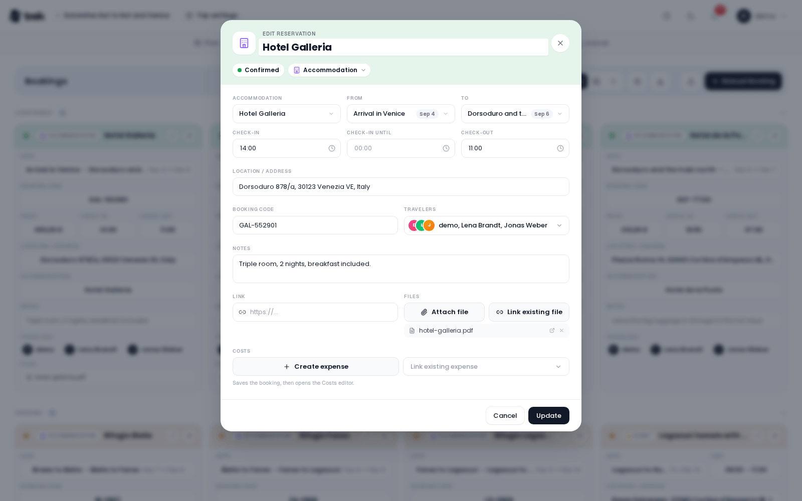

# AI Booking Import

The **AI Parsing** addon gives TREK's booking import a second reader. When [KDE Itinerary](Reservations-and-Bookings#import-from-booking-confirmation) cannot make sense of a confirmation (a plain-text email, an unusual PDF layout, a vendor whose format it does not know) TREK hands the document to an AI model and turns the answer into a booking you check before it is saved. With a model that reads images, it also reads photos of tickets.

The addon is **off by default**. It reads with the same AI connection the [AI assistant](#the-ai-assistant-and-this-addon) uses, and it also works with a model running on your own hardware, so booking data never has to leave your server.

> **Admin:** turn on **AI Parsing** in [Admin-Addons](Admin-Addons). AI Parsing, AI Assistant and MCP share one tile named **AI** in the *Integration* group, with a switch for each of the three. Once AI Parsing or the AI Assistant is on, the tile shows a **Set up AI** button that opens the dialog described in [Admin: setting up AI](#admin-setting-up-ai). Import works even without the `kitinerary-extractor` binary: with no extractor, the model reads every uploaded file instead of only the ones Itinerary cannot. Installing the extractor is still the better setup, since structured tickets stay fast and predictable and the model stays a fallback. Set up a connection and a model before anyone uses it, though. The import button appears as soon as the addon is on, and with neither an extractor nor a model the import fails.

## How it fits with normal import

AI parsing backs KDE Itinerary up, it does not replace it:

1. Every uploaded file goes to KDE Itinerary first.
2. Only the files Itinerary returns **nothing** for are sent to the AI model.
3. Whatever the model finds opens in the normal editor, one booking at a time, for you to check and correct before it is saved.

Structured tickets keep being read the fast, predictable way, and the model only steps in for documents that would otherwise fail. With the addon off, import works exactly as before. On a server without the extractor there is nothing to back up, and every file goes straight to the model.

AI results are marked for review internally, but the mark never reaches the card: saving in the editor stores each booking as checked.

## Which connection reads your files

AI parsing looks for a connection in this order and uses the first one it finds:

1. **The addon's own connection.** An admin can give AI parsing a connection of its own in the **Set up AI** dialog (**Own connection**). It is used for everyone and wins over everything below. Installs that set a model on the addon before the shared connection existed keep it.
2. **The shared AI connection.** The one the AI assistant runs on: a connection an admin set up once for everyone, or the one each person connected for themselves, depending on the admin's **Who pays** choice. This is the default, and the reason most installs never need a separate setup for parsing.
3. **A personal parsing model.** Only for people who saved one under **Settings → Integrations → AI parsing** before parsing could read with the shared connection. See [Your own connection](#your-own-connection).

If none of them exists, the import fails with an error shown in the widget.

Two details of the shared connection:

- A **ChatGPT** sign-in is not used for parsing. It only reaches ChatGPT's chat models, not the endpoint that parsing calls. Connect an API key (or another provider) for parsing instead.
- **Model reads images** is a setting of AI parsing itself and stays there, whichever connection reads. See [Photos](#photos).

## Choosing a provider

The shared connection of the AI assistant supports these providers:

| Provider | Runs where | Notes |
|----------|-----------|-------|
| **OpenAI** | OpenAI's API | Needs an API key. |
| **Anthropic** | Anthropic's API | Needs an API key. **Reads PDFs natively, scans included.** |
| **Gemini** | Google's OpenAI-compatible endpoint | Needs an API key. |
| **OpenRouter** | OpenRouter's API | **Connect OpenRouter** signs you in, so there is no key to copy. |
| **Sign in with ChatGPT** | ChatGPT | Uses a ChatGPT plan, no key. Chat only, not used for parsing. |
| **Own server** | Your own hardware, or any OpenAI-compatible service | Ollama, LM Studio, vLLM, llama.cpp, a LiteLLM proxy or a hosted endpoint such as Groq, at a **Server address** you enter: the one that `/chat/completions` follows, usually ending in `/v1` (`http://localhost:11434/v1`, `https://api.groq.com/openai/v1`). Ollama is read through its own API, every other server through `/chat/completions`. The API key is optional. |

To connect, pick **Sign in with ChatGPT**, **Paste an API key** or **Own server**. When you paste a key, TREK shows *Detected: {provider}*; if it cannot tell, it asks *Which provider is this key from?*. **Connect OpenRouter** is offered as its own button.

The addon's **Own connection** offers three providers of its own:

| Provider | Runs where | Notes |
|----------|-----------|-------|
| **Local (Ollama)** | Your own hardware | No booking data leaves your network. Recommended for privacy; runs on a CPU. |
| **OpenAI** | OpenAI's API, or any **OpenAI-compatible** endpoint through a custom base URL | Needs an API key. |
| **Anthropic** | Anthropic's API, or a gateway that speaks its Messages API through a custom base URL | Needs an API key. **Reads PDFs natively, scans included.** |

> **Scanned PDFs:** local and OpenAI-compatible models get the document's *extracted text*. A scanned PDF has no text layer. When the model reads images, the first two pages are drawn as images and sent like a photo; otherwise those providers return nothing for it. **Anthropic** receives the PDF itself and reads scans either way.
>
> **Long documents:** extracted text is sent up to 24,000 characters to a cloud model (OpenAI, Anthropic for anything that is not a PDF, OpenAI-compatible), and up to 6,000 to a local model (16,000 for a flight itinerary), since a CPU reads every character. A longer document keeps its start and its end, where the total and the payment summary sit, and loses the middle. The import then warns *long document, the middle part was not read*, so check the booking in the review. A self-hosted server whose context is too small for 24,000 characters (vLLM or llama.cpp with 8k tokens, say) refuses the request; TREK then asks once more with 8,000 characters, start and end kept, and warns the same way. Ollama's OpenAI-compatible endpoint cuts a long prompt without saying so, so use the **Local** provider for Ollama.
>
> **A total for the whole booking:** a round trip that states one total for all flights gets that price once, on the first flight, so saving every leg does not book the purchase twice. Fares the document lists per leg stay on their legs.
>
> **Photos:** a photo (JPG, PNG, WEBP) goes to the model as an image, with every provider, as long as the model reads images. See [Photos](#photos).

## Admin: setting up AI

**Set up AI** on the AI tile opens one dialog for the connection that the assistant and AI parsing share. A tab shows only while its addon is on: **Connection**, **AI Assistant** and **AI Parsing**. Every change saves at once.

### Connection

- **Who pays** decides whose connection is used: **I pay for everyone** (everyone uses the connection below and cannot add their own), **I pay, own allowed** (everyone uses the connection below unless they connect their own) or **Everyone uses their own account** (everyone connects their own provider and nothing is charged to you).
- **Connection for everyone** appears while you pay. Connect a provider from the list under [Choosing a provider](#choosing-a-provider), pick the **Model** (only models that can use tools are listed), and use **Change** or **Remove connection** later. API keys are stored encrypted.
- The **AI Assistant** tab holds the assistant's own limits: **Messages per person per day** (it only counts while you pay), **Keep chats** and **Web search**.

### AI Parsing

The **AI Parsing** tab starts with **Reads bookings with**, which shows the connection that reads right now, tagged **Shared** or **Own connection**:

- On the shared connection, **Use a different one** lets you give parsing a connection of its own. If there is no shared connection yet, the tab says so and offers a **Connection** button that takes you back to the first tab. With **Everyone uses their own account**, it says that each person reads with the connection set up in their settings.
- With an **Own connection**, **Use the shared connection** goes back. The own connection is *used instead of the shared connection*.

The form for an **Own connection** has these fields:

- **Provider**: **Local (Ollama)**, **OpenAI** or **Anthropic**.
- **Base URL**: empty means the provider's own address: `http://localhost:11434/v1` for a local Ollama server, `https://api.openai.com/v1` for OpenAI and `https://api.anthropic.com` for Anthropic. Any OpenAI-compatible endpoint goes here. For Anthropic it can name a gateway that speaks the Anthropic Messages API; give it without `/v1`, since TREK adds `/v1/messages`, and the gateway has to accept PDF document blocks and forced tool calls. Picking another provider empties the field, so an address meant for one never receives another provider's key.
- **API key**: optional for a local server (the field says *Often not needed*), required for the cloud providers. It is stored **encrypted** and shown masked (`••••••••`) once saved; leaving it unchanged keeps the stored key.
- **Model**: the model id, for example `qwen3.5:4b`, `gpt-4o` or `claude-opus-4-8`.

**Model reads images** sits below, with **Automatic**, **Yes** and **No**. With a local server, **Automatic** asks the Ollama server what the model can do (`/api/show`) and follows its answer. With a cloud model, **Automatic** means no, so choose **Yes** if your model reads images. **Yes** and **No** apply as set, whatever the server or the model id says. Photos are only accepted when this comes out as yes. The switch is shared by the booking import and by [Scan receipt](Budget-Tracking#scanning-a-receipt) in Costs.

### Pulling a local model

With **Local (Ollama)** selected in an own connection, the form manages your Ollama server directly:

- **Installed on the server** lists the models Ollama already has, with a **Refresh** button. Click a model to select it. Until one is installed, the list says *No models installed yet. Pull one below.*
- **Pull a recommended model** downloads a model with a live progress bar. The recommended one is **Qwen3.5 4B** (`qwen3.5:4b`, 3.4 GB, 256K context): small and quick on a CPU-only host, with "thinking" switched off automatically, under the Apache-2.0 licence. It reads images, so with **Model reads images** on Automatic it accepts photos. A PDF with a text layer reaches it as extracted text, a scanned one as its first two pages drawn as images. When the download finishes, the model is selected. **Pull** becomes **Use** once a model is on the server, and **Selected** for the one in use.

Any other model already on the server can be selected too, or typed in by hand. If the server cannot be reached, the form says *Could not reach the local server*.

## Your own connection

What a person sees in **Settings → Integrations** depends on the addons that are on and on the admin's **Who pays** choice:

- With the AI Assistant or AI Parsing on, an **AI connection** section lets you connect your own provider when the admin allows it, shows who answers and which model, and lets you sign out or disconnect. Its title reads *AI assistant* while the assistant is on, and *AI parsing* when only AI Parsing is. When the admin pays, the section shows *Provided by your admin*.
- A separate **AI parsing** section appears only for people who already saved a personal model there before parsing could read with the shared connection. It offers **OpenAI** or **Anthropic**, a **Model** id and an **API key**, which is stored encrypted; leave the key blank to keep the current one. There is no personal Base URL. The address the server calls is instance configuration, so a local Ollama server can only be set up by an admin. The server refuses a personal base URL or a personal `local` provider from anyone, admins included.

A personal parsing model has its own **Model reads images** switch, on or off. It decides whether photos are offered and sent to your model, both for the booking import and for [Scan receipt](Budget-Tracking#scanning-a-receipt) in Costs. PDFs are not affected: only Anthropic gets the raw PDF, every other provider the extracted text.

> **Precedence:** the addon's own connection always wins when an admin has set one. Otherwise the shared connection is used, and a personal parsing model only counts when there is neither.

## Importing a booking with AI

The upload is the normal booking import; the model simply works behind it.

1. In the trip, open the **Bookings** or **Transports** tab and click **Import booking confirmations** (the upload icon in the bar). On a tab without bookings, the button reads **Import from file**.
2. Drop your files onto the upload area: EML, PDF, PKPass, HTML or TXT, up to 5 files of 10 MB each. When the model reads images, photos (JPG, PNG, WEBP) are accepted too. Click **Import**.
3. The dialog closes and a **background widget** in the bottom right corner shows *Parsing files…* with a count. You can keep working meanwhile; the widget survives a reload and follows you to other pages.
4. When parsing is done, click **Import** in the widget.
5. Each booking found opens **pre-filled in its editor**, the reservation editor or the transport editor, one after the other. Check it, correct it, and save. Nothing is stored before you do.

### When nothing is found

If a job ends with *No reservations could be extracted from the uploaded files.*, the widget offers **Try AI parsing**. It sends the same files again in force-AI mode: KDE Itinerary is skipped and every file goes straight to the model. The button only appears on an empty result, and never on a run that was already forced. Without an instance or personal model, the retry fails with the error shown in the widget.

It is a retry, not another route. On a normal import the model has already seen every file Itinerary returned nothing for, so it is mostly worth pressing when the addon or the model was set up after the job started. A document Itinerary *did* read cannot be pushed through the model: as soon as a parse finds any booking, the widget shows **Import** and no retry. Fix such a booking in the editor instead.

### What gets filled in and created

The model is asked for the complete booking, **every leg of a multi-segment flight** included. When you save, TREK ties each booking into the trip:

- **Fields**: the booking code, dates and times, and depending on the type the seat, class, platform, total price and currency. Hotels bring their address, rental cars their company, restaurants and events their venue with phone number and website.
- **Places**: only a **hotel** becomes a trip place. The editor reuses a trip place with a matching name; otherwise it looks up the address you checked and creates a place, so the pin appears on the map. Transport stops are located while the files are parsed and stored as the booking's **From** and **To**, not as trip places. A stop that could not be located is listed as a warning in the widget and dropped when you save, so fix it in the editor first. Restaurant and event venues arrive as the booking's address only; the editor can link a place the trip already has, but it never creates one.
- **Accommodations**: a hotel booking creates the stay on the check-in and check-out days.
- **Linked cost**: when the [Costs addon](Budget-Tracking) is on and the booking has a price, a linked expense is created in the currency the price was quoted in. Without the addon, the price stays on the booking.
- **Source document**: the uploaded file is attached to the booking.

## The AI assistant and this addon

The in-app [AI assistant](Addons-Overview) can read a booking confirmation too. Attach the file to the chat (**Attach a booking**) and the assistant proposes an **Add booking from file** card that you confirm before it is saved. The file can be kept in the trip's Files, alone or together with the booking (**Keep the file with this booking**).

Use the import button on the Bookings or Transports tab when you have several files or want the normal editor review for each. Use the assistant when you are already talking to it about the trip. Both read with the same AI connection. The assistant also needs the AI Assistant addon; the import widget needs only AI Parsing.

Receipt scans in Costs use the shared connection as well, with the vision setting kept in AI Parsing. See [Budget-Tracking](Budget-Tracking#scanning-a-receipt).

## Photos

When the model reads images (see **Model reads images** above), the import takes photos as well: a phone picture of a paper train ticket, a boarding pass, a hotel confirmation. The upload dialog then says *Photos (JPG, PNG, WEBP) are read by the AI model.*, and a photo goes through the same background job, review and linked cost as any other file.

- A photo always goes to the model. KDE Itinerary is not asked, since it reads documents, not pictures.
- A scanned PDF without a text layer is read the same way: its first two pages are drawn as images and sent to the model.
- A photo is shrunk to 1600 px on its longest side before it is sent. A model pays for every pixel and does not read a ticket better at twelve megapixels; a local `qwen3.5:4b` on a CPU took several times longer on the same ticket at full size.
- A photo over 40 megapixels is refused, with a warning naming the file, before it is even decoded. So is a WEBP over 3.5 MB: TREK shrinks JPG and PNG but cannot shrink a WEBP, and the providers take no more than that.
- HEIC is not accepted. A phone's photo picker hands over a JPEG anyway.
- When the model does not read images, the dialog does not offer photos, and the server refuses one sent anyway with *The configured AI model does not read photos*.

Photographing a receipt for the Costs tab is covered in [Budget-Tracking](Budget-Tracking#scanning-a-receipt).

## Good to know

- **Nothing to migrate**, and everything is set up in the UI. The only environment variables the addon reads are `LLM_TIMEOUT_MS` and `LLM_MAX_OUTPUT_TOKENS` (see [Environment-Variables](Environment-Variables)).
- **Local models can be slow.** On a CPU-only host one booking can take from tens of seconds to a couple of minutes. TREK gives a model 15 minutes per document by default; `LLM_TIMEOUT_MS` raises or lowers that. Uploads are parsed **one at a time** per user, so several files wait in line rather than run in parallel.
- **A long booking list can outgrow the answer.** A model may write at most 4096 tokens per document (8192 on Anthropic). When a document holds more than that, the import says the answer was cut off; `LLM_MAX_OUTPUT_TOKENS` raises the cap, as far as your model's context allows.
- **Parse jobs are kept for about 10 minutes** after they finish. Start the review within that time.
- **Privacy**: with the Local provider or an own server nothing leaves your network. With OpenAI or Anthropic, the document's text (for Anthropic the PDF itself, and for either a photo) is sent to that provider.
- **API keys are never sent back in plain text.** They are encrypted at rest and only ever shown masked.

## See also

- [Reservations-and-Bookings](Reservations-and-Bookings), the import this addon extends
- [Transport-Flights-Trains-Cars](Transport-Flights-Trains-Cars)
- [Admin-Addons](Admin-Addons)
- [Budget-Tracking](Budget-Tracking), for linked costs and receipt scans
- [AI-Connections](AI-Connections), the connection AI Parsing can share with the assistant
- [AI-Assistant](AI-Assistant)
