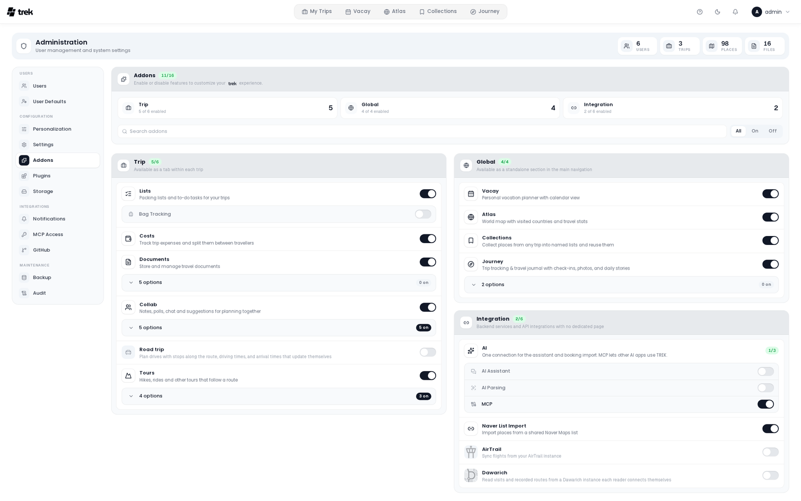

# Admin: Addons

The **Addons** tab (in the **Configuration** group of the admin side navigation) lets you enable or disable optional features for the entire TREK instance. Toggling an addon affects all users immediately: disabling one hides its UI elements and blocks its API routes instance-wide.

## What addons control

Each addon toggle controls a feature set. When you disable an addon, users lose access to that feature everywhere in the app. No data is deleted; re-enabling the addon restores access to existing data.

## Addon categories

The tab opens with a head card, **Addons**, that shows how many addons are on as a pill (for example `8/16`; hover it for **{enabled} of {total} enabled**). Under it sit three tiles, one per type (**Trip**, **Global** and **Integration**), each with its own count, then a **Search addons** field that finds an addon by name or description and an **All**, **On** and **Off** switch that filters the list.

Below the head card the addons are grouped in one card per type. From extra-wide screens the **Trip** card sits on the left and the **Global** and **Integration** cards are stacked on the right; on narrower screens all three are stacked. A card's head names the type with a short hint and counts how many of its addons are on. Each addon is a tile with its icon, name, description and switch; its sub-toggles open underneath the tile while it is on, and a long list is folded behind an options bar.

### Trip addons

Trip addons add per-trip feature panels. They appear in every trip where the addon is enabled.

The trip addons are: **Lists**, **Costs**, **Documents**, **Collab** and **Tours** (all enabled by default), and **Road trip** (disabled by default). The exact list is determined by what is registered in your TREK database.

**Sub-toggles on trip addons:**

- **Lists**: when enabled, a nested **Bag Tracking** toggle appears. Bag Tracking lets users assign packed items to specific bags.
- **Collab**: when enabled, five sub-toggles appear for individual collaboration features:
  - **Chat**: in-trip real-time chat
  - **Notes**: shared trip notes
  - **Links**: shared trip links, on by default
  - **Polls**: trip polls
  - **What's Next**: the "what's next" widget
- **Documents**: when enabled, one row per document store appears underneath: **Paperless-ngx**, **Papra**, **Nextcloud**, **OpenCloud** and **Synology Drive**. All of them are off by default. Switching a store on only lets trip owners offer it; the address and credentials are entered per trip, in the trip's file manager. Switching a store off pauses the trips bound to it without touching them. Switching **Documents** itself off switches every store off, and each has to be switched on again afterwards; a store cannot be switched on while **Documents** is off. See [Document-Sync](Document-Sync).

Each sub-toggle can be disabled independently while the parent addon remains enabled.

**Road trip** plans a trip as one continuous drive: search along the route, driving limits, daily travel times, via points and avoidance of toll roads, motorways and ferries. **Disabled by default.** It needs no key: routing runs on the public OSRM and Valhalla servers until you set your own under **User Defaults** (**Own routing engine**, **Own Valhalla instance**, restart required). See [Road-Trip](Road-Trip).

**Tours** plans hikes, bike rides, ski tours, paddle tours (kayak, canoe, SUP) and other tours as tours of their own and adds them to the days of a trip. **Enabled by default.** Underneath its tile are four switches that decide which outside services Tours may use:

- **wanderer**: lets users connect their own wanderer instance and import its trails. Each user can also switch on a background check of the trails they imported (Settings, Integrations, wanderer): TREK then reads the small record of each such trail at most once a day, never its GPX, and leaves a notification when the trail may have changed. It never changes a tour; taking a change in stays the user's own check and confirmed reimport. Switching wanderer off here stops those checks too.
- **Hiking map (OpenHikingMap)**: offers OpenHikingMap as a base map in the tour planner. It is free for non-commercial installs up to 500,000 tiles a month; a commercial or larger install needs an agreement with openmaps.fr first.
- **Cycling map (CyclOSM)**: offers CyclOSM as a base map for bike tours. OpenStreetMap France serves it for moderate use; a heavy or commercial install switches it off or reaches an agreement with the operator first.
- **Piste router**: plans ski tours along runs, lifts and trails on the piste data of the Places server. Switched off, the legs of a ski tour are drawn straight.

Each of these changes is recorded in the [Audit-Log](Audit-Log).

#### Paddle water data

While **Tours** is on, a **Paddle water data** card appears under the addons. It holds the regions TREK knows weirs, dams, locks, rapids, put-ins, take-outs, portage ways and paddling rules for. TREK reads them from OpenStreetMap, from the regional extracts Geofabrik publishes, with a reader of its own; no other service is asked.

1. Search the card for a region, for example *Oberpfalz*. Each hit shows the regions it lies in, so two places of one name tell apart.
2. Click **Add**. TREK downloads the extract in the background, reads the paddle objects out of it, builds the region's water network from the same read and deletes the file. The card shows the download, the reading and the building with their progress, without reloading the page. A large region takes a few minutes; regions are read one after another.
3. Once the region is **Ready**, the card shows how many objects it holds, the date its data is current to and how many kilometres of water its network holds (lakes, mapped and assumed portages, locks and bridged gaps in its tooltip). A region read with an older TREK shows **No water network** until it is read again.

**Load regions automatically.** The card also decides what happens when someone plans a paddle tour where no water data exists yet:

- **Automatic** (the default): TREK loads the smallest matching region right away, up to **Largest region loaded automatically** (500 MB unless you change it) and at most five regions a day. Anything larger, or anything past the daily limit, waits in a **Requested** list. Only the region's name goes to Geofabrik, never the place.
- **On request**: every new region waits in the **Requested** list until an admin lets it through. When an admin plans the tour, the region loads right away.
- **Off**: TREK loads nothing by itself and asks for nothing; add regions by hand.

Each entry in **Requested** shows who asked and why it waits (**On request**, **Too large** or **Daily limit**). **Load** reads the region, **Decline** removes the request. Admins get a **Paddle region requested** notification when a request arrives, see [Admin-Notifications](Admin-Notifications). Regions TREK loaded by itself are tagged **Automatic**.

Paddle tours inside a region show its obstacles on the planner map, each with a card that says how it stands to the route, what paddling rule its tags give and how current the data is. Outside every region a paddle tour says that no obstacle data is known there; TREK never shows the water as free of obstacles.

**Routing on the water.** Inside a region the planner plans a paddle tour along rivers and canals and across lakes, the way it routes a hike on paths: set the put-in and the take-out, and the route follows the water. Where a weir, dam or waterfall bars the way it carries round it, on a mapped portage way where there is one and on a short straight carry where there is none, and it goes through open locks. A click on the route sets a shaping point that steers it, for example to one side of an island. Lakes are crossed straight over or near the shore, as each tour chooses; on a windy day the wind card suggests the shore. A leg TREK cannot plan, because a point lies off the water or between two regions, stays a straight red line until it is moved or drawn by hand on purpose. The router runs in a thread of the server itself; no other service is asked. Each region's network is a file in the data folder (a large region takes a few megabytes) and is built again with every read.

**Monthly refresh.** Every region with data is read again on the 3rd of every month at 04:20 (server time); **Read again** does it at once. A read that fails keeps the data read before and shows the reason. A restart during a read queues it again. **Remove region** deletes a region and its objects after a confirmation.

**Data and licence.** The objects are OpenStreetMap data, © OpenStreetMap contributors, under the Open Database License (ODbL); TREK shows the attribution next to them. A record in the data is no check on site: weirs, locks and rules change, and the data can have gaps. The download needs outbound access to Geofabrik's server and, while a region is read, room for its extract in the data folder's temporary space (a whole country takes a few gigabytes).

### Global addons

Global addons add features that are not tied to a single trip. The default global addons are **Vacay**, **Atlas**, **Collections**, and **Journey**.

- **Vacay**: personal vacation day planner with calendar view. Enabled by default.
- **Atlas**: world map of visited countries with travel stats. Enabled by default.
- **Collections**: personal place library that saves places across trips into named lists, copies them into any trip, and shares them. **Disabled by default.** See [Collections](Collections).
- **Journey**: trip tracking and travel journal (check-ins, photos, daily stories). **Disabled by default.** See [Journey-Journal](Journey-Journal).

**Sub-items on global addons:**

- The **Journey** addon shows photo provider toggles underneath it. Each photo provider (e.g., Immich, Synology Photos) can be enabled or disabled independently.

### Integration addons

Integration addons connect TREK to external services. Most of them need additional configuration (API keys, URLs) once enabled, but not in the admin **Settings** tab: each one has its own place.

- The **Naver List Import** addon imports the places of a shared Naver Maps list into a trip. **Enabled by default.** It needs no key.
- The **AirTrail** addon syncs flights from a self-hosted AirTrail instance. **Disabled by default.** The toggle here is the instance-wide switch only; each user connects their own instance (URL + API key) in **Settings → Integrations**.
- The **Dawarich** addon reads the stays and recorded routes of a self-hosted Dawarich instance and offers them as suggestions. **Disabled by default.** The toggle here is the instance-wide switch only; each user connects their own instance (address + API key) in **Settings → Integrations**. A Dawarich on your local network also needs `ALLOW_INTERNAL_NETWORK=true`. See [Dawarich](Dawarich).
- The three AI addons share one tile, described next.

#### The AI tile

**MCP**, **AI Parsing** and the **AI Assistant** do not have a tile each. They are one tile named **AI** at the head of the **Integration** card ("One connection for the assistant and booking import. MCP lets other AI apps use TREK."), with a pill that counts how many of the three are on and one switch row for each. All three are **disabled by default**.

- **AI Assistant**: a chat in the trip that reads the plan and proposes changes you confirm.
- **AI Parsing**: the LLM fallback for booking imports KItinerary cannot read. See [AI-Booking-Import](AI-Booking-Import) and [Budget-Tracking](Budget-Tracking#scanning-a-receipt).
- **MCP**: lets other AI apps use TREK through the Model Context Protocol. It requires `APP_URL` to be set in your environment. While it is on, the **MCP Access** tab appears in the Admin Panel. See [MCP-Overview](MCP-Overview) for full details.

Below the switches, **Set up AI** opens a dialog for the connection and limits. The button appears while the AI Assistant or AI Parsing is on; every change in the dialog saves at once. It has up to three tabs, and a tab only shows while its addon is on:

- **Connection**: **Who pays** is a choice of three. **I pay for everyone** gives everyone the connection below and they cannot add their own. **I pay, own allowed** does the same unless someone connects their own account. **Everyone uses their own account** charges nothing to you; each person connects a provider in **Settings → Integrations**. Unless everyone uses their own, **Connection for everyone** holds the shared connection: sign in with ChatGPT or OpenRouter, paste an API key (Anthropic, OpenAI, Gemini and others), or use **Own server**, any OpenAI-compatible server such as Ollama with its **Server address** and an optional API key. Pick the **Model**, and **Remove connection** takes it away again. If you share your own ChatGPT plan, a notice reminds you that everyone's chats count against it. A server on your own network goes through the relaxed guard, see [Internal-Network-Access](Internal-Network-Access).
- **AI Assistant**: **Messages per person per day** (it only counts while you pay), **Keep chats** for 30 days, 90 days, 365 days or forever, and a **Web search** switch that lets the assistant look things up through the search of the AI provider it talks to (it works with ChatGPT, Anthropic and OpenRouter, and the searches go only to that provider).
- **AI Parsing**: **Reads bookings with** shows whether parsing uses the shared connection or an **Own connection**. For an own connection pick a provider (**Local (Ollama)**, **OpenAI** or **Anthropic**), the base URL, API key and model, and set **Model reads images** (**Automatic**, **Yes** or **No**). Automatic asks a local Ollama server whether the model reads images and means no for a cloud provider. When it resolves to yes, the booking import takes photos (JPG, PNG, WEBP) and scanned PDFs are read page by page, and Costs offers **Scan receipt**. For a local Ollama the tab also lists the models **Installed on the server** and lets you **Pull a recommended model**. Leaving parsing without a connection of its own lets each user configure their own in **Settings → Integrations**.

The Settings screen of each user shows the matching **AI assistant** card, see [User-Settings](User-Settings#integrations-tab).

## Enabling or disabling an addon

Click the switch on any addon tile. The change is applied immediately; no save button is needed. A brief success toast confirms the update.

If a toggle fails (e.g., network error), it rolls back to its previous state.

## Additional configuration

Some addons require credentials or environment variables before they are functional:

- **Documents**: the document stores need nothing instance-wide beyond their switch. The trip owner enters a store's address and credentials in the trip's file manager. A store on your local network also needs `ALLOW_INTERNAL_NETWORK=true`. See [Document-Sync](Document-Sync) and [Internal-Network-Access](Internal-Network-Access).
- **Journey**: works without any external integration. To embed photos from Immich or Synology Photos, enable the corresponding photo-provider toggle listed under Journey, then configure credentials per-user in **Settings → Integrations**. See [Photo-Providers](Photo-Providers).
- **MCP**: requires `APP_URL` to be set so OAuth redirect URIs resolve correctly.
- **AI Assistant** and **AI Parsing**: need a connection, either one shared for everyone under **Set up AI** or one per person in **Settings → Integrations**.
- **Road trip**: works out of the box on the public routing servers. To use your own OSRM or Valhalla, set **Own routing engine** or **Own Valhalla instance** under **Admin → User Defaults**, then restart the server and reload the page. See [Road-Trip](Road-Trip#routing-engines).
- **Tours**: hikes need nothing more. For the obstacles on paddle tours, add the regions you paddle in under **Paddle water data** (see above), or let TREK load them.

## On a phone

The phone admin has the same addon list in its **Addons** section, with the same switches, the AI tile and the **Paddle water data** regions.

## Related pages

- [Admin-Panel-Overview](Admin-Panel-Overview)
- [Admin-MCP-Tokens](Admin-MCP-Tokens)
- [MCP-Overview](MCP-Overview)
- [Addons-Overview](Addons-Overview)
- [Document-Sync](Document-Sync)
- [AI-Connections](AI-Connections)
- [Wanderer](Wanderer)
