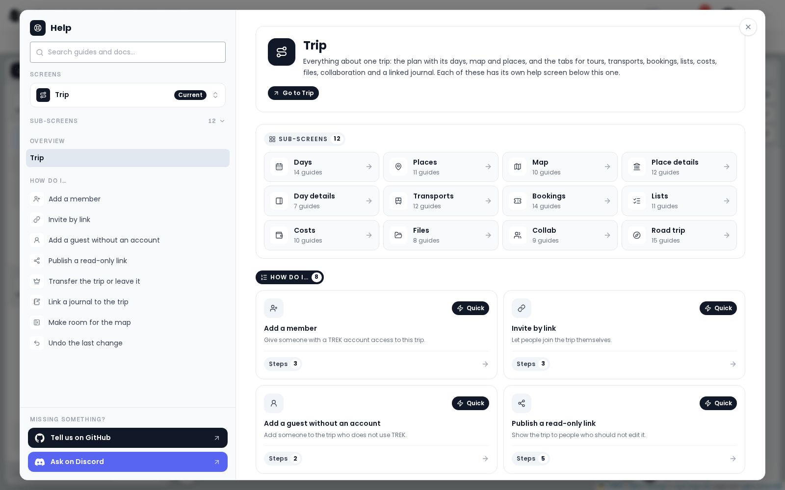
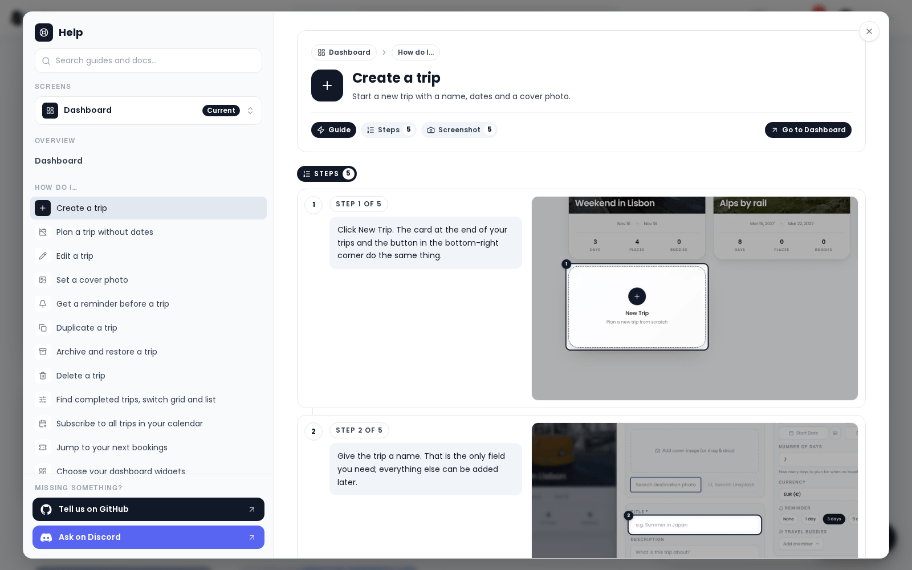

# Help Center

The help center is TREK's built-in guide to the screen you are on. It answers "what is this?" and
"how do I do that?" without leaving the app, with a picture of every step taken from TREK itself.

It is not the same thing as [In-App Help](In-App-Help), which is this wiki, rendered inside TREK at
`/help`. The help center is the `?` panel; it links into the wiki wherever the reference
documentation continues.

## Opening it

Click the **?** (**Help for this screen**) in the navbar, next to the theme toggle. In Journey's
Studio, which has no navbar, the same **?** sits in the Studio toolbar. There is no keyboard
shortcut, on purpose: it would fire while you were typing a question mark into a note.

The panel opens over the app, already on the screen you were looking at. **Escape** closes it, and
the focus goes back to the `?`. If you opened a dialog while following a guide, Escape closes that
first.

The `?` is hidden on phones. It shows from a window width of 640 px up, so tablets and narrow desktop windows have it too.

## What is in it

The panel has navigation on the left and the content on the right.

### The screen you are on

The overview of a screen opens first. It carries:

- the screen's **name and summary**, with a breadcrumb that says where it sits,
- **Go to <screen>**, which closes the panel and takes you there,
- a **full-frame picture** of the screen as you find it,
- **On this screen**, a numbered list of what the screen holds and what each part does,
- **How do I…**, a card per guide,
- **In the docs**, the wiki pages that go deeper. A guide's link to them reads **Open in Help & Docs**.

A screen that has sub-screens lists them under **Sub-screens**, folded: the trip folds its plan
columns, its panels and its tabs (including Place details, Day details and Road trip); Settings and the Admin panel fold their tabs; Journey folds the
journal and the studio. Dashboard, Vacay, Atlas, Collections and the Notifications inbox have help of their own.

### Guides

A guide is one task, start to finish. It opens with the goal and a chip that says how long it is,
**Quick**, **Guide** or **Walkthrough**, then:

1. **Steps**, numbered. Each step is one sentence naming the app's own buttons and fields, with a
   picture beside it. The picture is framed on the thing the sentence tells you to use, ringed in
   your accent colour and numbered to match. A step that asks you to drag something shows both ends
   and an arrow between them. Some steps show a short looping clip instead of a still, so you see the movement; with your system set to reduce motion, the still is shown instead. Click a picture to open it full size.
2. **What you get**, which says what changed, often with a picture of the result.
3. **Good to know**, the caveats: what needs an addon, what cannot be undone, what a permission
   hides.
4. **Related**, the guides that go with this one, and **In the docs**, the wiki pages behind it.

Some guides carry a button that takes you straight to the screen the task happens on.

### Search

The box at the top left searches **guides and the wiki at once**, from anywhere in the panel,
including from inside a guide. Clearing it puts you back where you were.

### The screen switcher

**Screens** lists every screen that has help, so you can read about one screen while standing on
another. Screens with sub-screens fold, two levels at most: the trip with its columns and tabs, and
**Tours** with its list, its map and one screen per kind of tour. The one you are actually on is
marked **Current**.

A screen's overview shows its sub-screens as cards right under its title, each with the number of
guides it holds, and the navigation lists the screens next to the one on show. The wiki pages that
go with a screen are listed once, at the foot of its overview.

### Asking a person

At the bottom of the navigation, under **Missing something?**, are the two places to ask a person:
**Tell us on GitHub** opens a discussion, **Ask on Discord** opens the chat. They are there on
every screen.

## The pictures

Every picture and clip is generated by driving the real app: same viewport, same theme, same language, same
demo trip, on every screen. Nothing is drawn, cropped or retouched by hand, and a picture only
exists if the steps it shows still work. When a button moves or a label changes, the run that makes
the pictures fails, which is how the guides stay honest.

The pictures and clips ship with your install as WebP and are loaded only when you open the panel, so they
cost nothing to a visitor who never asks for help.

## Languages

The guides are written in English first and translated into all 27 languages TREK speaks (see
[Languages](Languages)). Every button
and field a guide names is the app's own string in that language, so what you read matches what you
see.

## When a screen has no help yet

The panel says *No guide for this screen yet.* and leaves the search box as the way forward, with the
**Tell us on GitHub** and **Ask on Discord** links below the navigation.

## See also

- [In-App Help](In-App-Help) - the wiki rendered inside TREK at `/help`
- [Trip Planner Overview](Trip-Planner-Overview)
- [FAQ](FAQ)
- [Troubleshooting](Troubleshooting)
