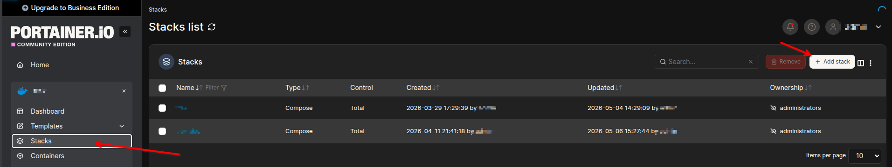
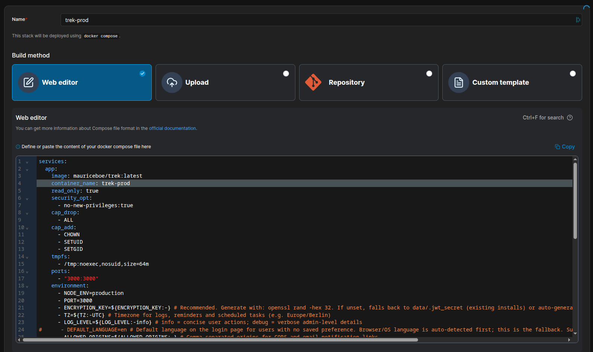
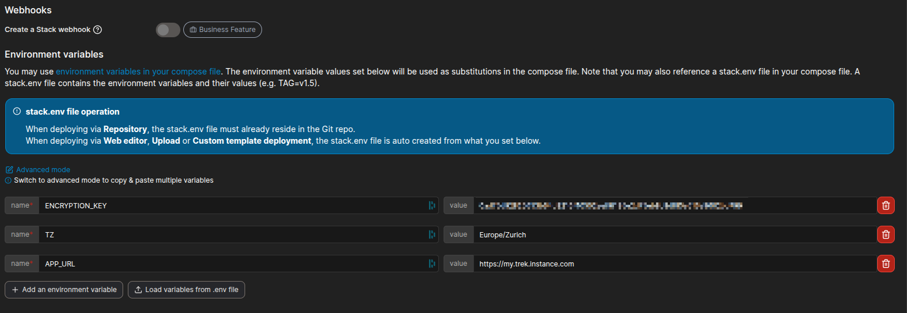
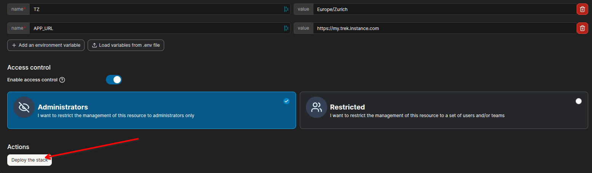
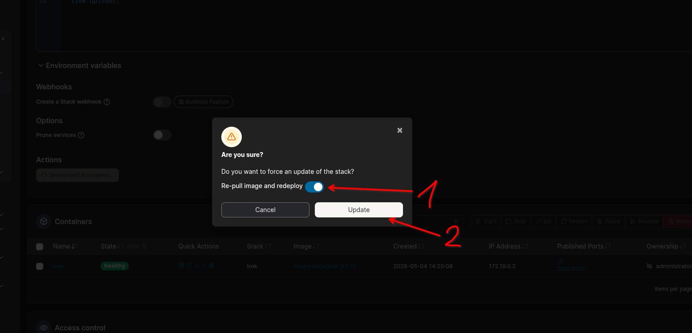
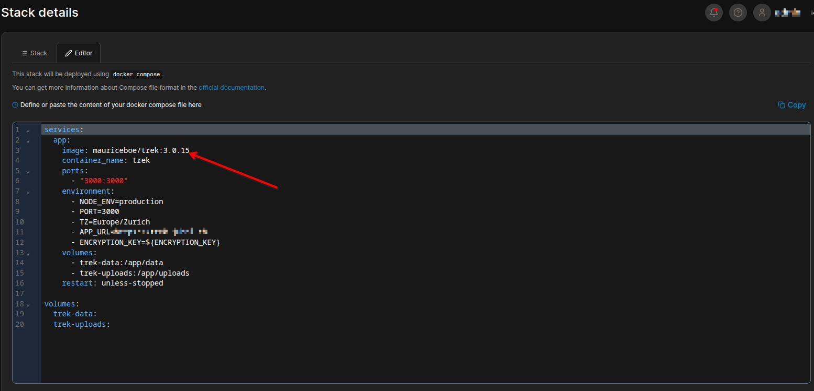
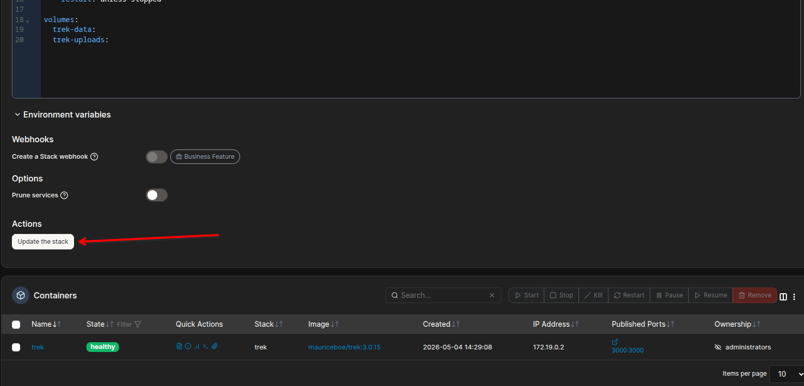

# Install: Portainer

Install TREK on Portainer using a Stack (Docker Compose).

## Prerequisite

Portainer must be installed and connected to your Docker environment. Use **Stacks**. They support Docker Compose and give you the full compose syntax, including environment variables, volumes, the healthcheck and restart policies.

## Create a Stack



1. In Portainer, go to **Stacks → Add stack**.
2. Give the stack a name (e.g. `trek`).
3. Select **Web editor** and paste the compose file from [docker-compose.yml](https://github.com/liketrek/TREK/blob/main/docker-compose.yml). Keep it complete, including the `read_only` and `cap_drop` hardening, the `healthcheck` block and the `logging` block, so Portainer can show the container's health and Docker does not let the log grow without limit.



4. Fill in the environment variables at the bottom of the page. Use **Advanced mode** to paste several `KEY=value` lines at once.



5. Click **Deploy the stack**.



## Check That It Runs

Open **Containers** in Portainer. After the first 15 seconds or so the `trek` container shows a green **healthy** status, because the compose file defines a healthcheck that polls `/api/health` and follows a changed `PORT`. While it still says `starting`, TREK is booting or migrating its database.

Then open `http://<host>:3000`. On the very first start TREK creates an admin account. Without `ADMIN_EMAIL` and `ADMIN_PASSWORD` (both are needed, and they only apply on that first start) it uses `admin@trek.local` with a random password. Find the password in the container's log: **Containers → trek → Logs**. See [Quick-Start](Quick-Start).

## Compose Content

See https://github.com/liketrek/TREK/blob/main/docker-compose.yml

Set at minimum `ENCRYPTION_KEY`, `TZ`, and `ALLOWED_ORIGINS` in the **Environment variables** section of the stack editor. Portainer's stack variables are only substituted into `${...}` placeholders in the compose file, they are not injected into the container, and the shipped compose file interpolates exactly four: `ENCRYPTION_KEY`, `TZ`, `LOG_LEVEL`, and `ALLOWED_ORIGINS`.

Every other variable ships commented out, so setting it here does nothing. To use one, for example `APP_URL`, which OIDC needs and which email notification links are built from, uncomment its line in the **Web editor** and put the value there directly, or change it to `- APP_URL=${APP_URL:-}` so the stack variable is picked up.

> Change a variable later by editing the **stack** and redeploying it, never by editing the container in place. Portainer's container editor rewrites the container's start-up command as well, which leaves it unable to boot; see [Troubleshooting](Troubleshooting#container-wont-start-syntax-error-end-of-file-unexpected-expecting-fi).

Generate an encryption key with:

```bash
openssl rand -hex 32
```

## Image Tags

Five tags are available:

| Tag | Example | Behavior |
|---|---|---|
| `latest` | `mauriceboe/trek:latest` | Always the newest release across all major versions |
| Major version | `mauriceboe/trek:5` | Latest release pinned to that major version |
| Minor version | `mauriceboe/trek:5.0` | Latest patch of that minor version; never moves to the next minor. Published from 5.0.0 on |
| Full version | `mauriceboe/trek:5.0.0` | Exact release; never changes |
| `latest-pre` | `mauriceboe/trek:latest-pre` | Test build of the next version; not for production |

Use `latest` or a major-version tag (e.g. `5`) if you want automatic updates on redeploy. Use the minor tag (e.g. `5.0`) to receive patch releases only, or a full version tag (e.g. `5.0.0`) if you want explicit control over which release runs.

## Updating

How you update depends on the tag you chose:

**`latest`, major-version or minor-version tag.** In Portainer, open the stack and go to the **Editor**. Switch on **Re-pull image and redeploy**, then click **Update the stack**. Portainer pulls the newest matching image and recreates the container.



**Pinned full-version tag.** Edit the stack, change the tag in the `image:` line (e.g. `5.0.0` → `5.0.1`), then click **Update the stack**. No need to toggle the re-pull switch, because a changed tag forces a fresh pull.





When the new container starts, TREK first copies the database to `data/pre-migrate-<schema>-<time>.db`, so you can go back to the previous image if an update does not suit you. See [Updating](Updating).

> Back up your data before any update. Go to **Admin Panel → Backup** or copy your `./data` and `./uploads` directories. See [Backups](Backups).

## Volumes

| Stack-relative path | Container path | Contents |
|---|---|---|
| `./data` | `/app/data` | SQLite database, logs, encryption key, installed plugins |
| `./uploads` | `/app/uploads` | Uploaded files (photos, documents, covers, avatars) |

Portainer resolves `./` relative to the stack's working directory. Confirm the paths under **Stack details** after deploying.

Installed plugins live under `data` by default, so they persist with it. If you move them with `TREK_PLUGINS_DIR`, give that directory a volume of its own as well, or they are gone after the container is recreated.

### Named Volumes

You can use Docker named volumes instead of bind mounts. Named volumes are fully managed by Docker and not tied to a host path, a good fit for Portainer where the working directory can vary. See the [Docker Compose volumes reference](https://docs.docker.com/reference/compose-file/volumes/) for all options.

Replace the `volumes:` block in the service and add a top-level declaration:

```yaml
services:
  app:
    # ... (rest of service config unchanged)
    volumes:
      - trek_data:/app/data
      - trek_uploads:/app/uploads

volumes:
  trek_data:
  trek_uploads:
```

Portainer lists named volumes under **Volumes** in the sidebar, where you can inspect or back them up.

## Next Steps

- [Environment-Variables](Environment-Variables): full variable reference
- [Reverse-Proxy](Reverse-Proxy): HTTPS configuration
- [Updating](Updating): update strategies across all install methods
