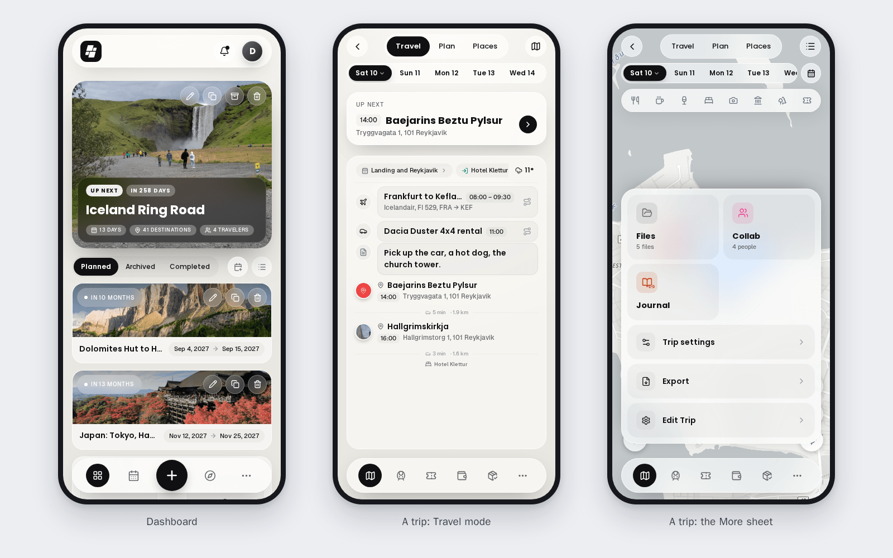

# TREK on a Phone

TREK has a layout of its own for phones. It is the same app at the same address with the same data, drawn for one hand and a small screen: a floating bar at the bottom, sheets that slide up instead of dialogs, and a trip screen built around the day you are on. Install it to your home screen and it behaves like an app; see [Offline-Mode-and-PWA](Offline-Mode-and-PWA).

## When the phone layout applies

TREK switches to the phone layout when the window is narrower than 768 px, and also on a touch screen less than 500 px tall, so a phone turned on its side keeps the phone layout instead of jumping to the desktop planner. A tablet and a desktop window follow their width as usual. Turning the phone or resizing the window switches between the two layouts on the fly.

## The bottom bar

Outside a trip a floating bar sits at the bottom of every screen:

- **My Trips** (the dashboard) always comes first.
- Two more destinations next to it, taken from the global addons your instance runs: by default the first two of Vacay, Journey, Atlas and Collections that are switched on.
- **More** lists the rest: the other addons, page plugins, and the [AI Assistant](AI-Assistant) at the top when it is set up for you.
- The raised button in the middle does what fits the screen: on the dashboard it creates a trip, on the journey list it starts a journey, inside a journey it adds an entry (or uploads a photo while the gallery is open), on Collections it adds a place to the open list, and on the Atlas it searches for a country. On Settings and the Admin screens it is a plain logo, and Vacay uses it for its own year and edit switch.

**Customising the bar.** On a phone, **Settings → Appearance** has a **Mobile** card with **Bottom navbar**: choose which items sit **In the bar** and which go **Under “More”**. **My Trips** stays first; two items fit next to it. The same card sets the **Dashboard order**. See [Appearance-Settings](Appearance-Settings#on-a-phone).

## The dashboard

The phone dashboard leads with the trip that is under way or comes next, then your other trips and the widgets you chose for the phone. At the top sit the bell for the [notifications inbox](Notifications-Inbox) and, when it is set up, the assistant. Which widgets show is set separately for desktop and phone in **Settings → Appearance**; see [Dashboard-Widgets](Dashboard-Widgets).

## A trip

A trip opens on its own screen with glass controls over the map, a row of day chips, and its own dock at the bottom.

**The trip dock** holds up to five of the trip's sections, in this order of priority: **Plan**, **Road trip**, **Transports**, **Bookings**, **Costs** and **Lists**. Only the sections switched on for the trip take a seat, and when there are more than five, the last ones move into **More**. Turning the road trip addon on, for example, moves the lists into **More** rather than leaving the drive without a seat.

**The Plan section** has three modes at the top:

| Mode | What it is for |
|---|---|
| **Travel** | Following the day on the road: the day's timeline with what is up next, **Jump to today**, and a way to navigate to each stop |
| **Plan** | Changing the day: reorder stops by dragging, add places, notes and bookings, rename the day |
| **Places** | Browsing the trip's places, filtering them, and adding one to a day; a switch at the top flips to the trip's saved tours |

Swipe sideways to go from day to day, or tap a day chip. A button switches between the list and the map; the map and the list are the same in every mode.

**The More sheet** of a trip starts with **Ask TREK** when the assistant is available, showing how many things in your plan are worth a check. Below come tiles for the sections that did not get a dock seat (such as Files, Collab and plugin tabs), then **Trip settings** ([Trip-Settings](Trip-Settings)), **Export** and, if you may edit the trip, **Edit Trip**.

**Export** on a phone offers the trip as a **PDF**, **My plan as PDF**, the GPX tracks of the **Whole trip**, **Download .ics**, and **Subscribe to calendar**, which keeps your calendar app up to date. See [PDF-Export](PDF-Export) and [Calendar-Feeds](Calendar-Feeds).

## The other screens

| Screen | On a phone |
|---|---|
| [Journey](Journey-Journal) | Your latest journey on top and the others below; entries as a timeline, photos from the device or from your photo library |
| [Atlas](Atlas) | The world map with **Visited** and **Planned**, and the middle button as the country search |
| [Vacay](Vacay) | The calendar month by month, with used and remaining days and **Edit calendar** in the middle button |
| [Collections](Collections) | Your lists, with each place's status |
| [Notifications](Notifications-Inbox) | The inbox as a full screen |
| [Settings](User-Settings) | The same tabs as screens of their own |
| [Admin](Admin-Panel-Overview) | One screen with the counters on top and a picker for the sections |

## What stays on the desktop

A few things need a bigger screen and are not offered on a phone:

- [TREK Studio](TREK-Studio), the photo book designer, and making its PDF.
- Parts of the road trip planner: comparing route alternatives, making a day follow an imported track, and booking a night at a stop. The phone shows these as **Planned on desktop**.
- The **Tours** tab, where tours are drawn and edited. Saved tours show on the phone under **Places**, ready to put on a day.
- The **API Keys** section of **Settings → Integrations**.

## See also

- [Offline-Mode-and-PWA](Offline-Mode-and-PWA)
- [Appearance-Settings](Appearance-Settings)
- [AI-Assistant](AI-Assistant)
- [Notifications-Inbox](Notifications-Inbox)
- [Trip-Settings](Trip-Settings)
