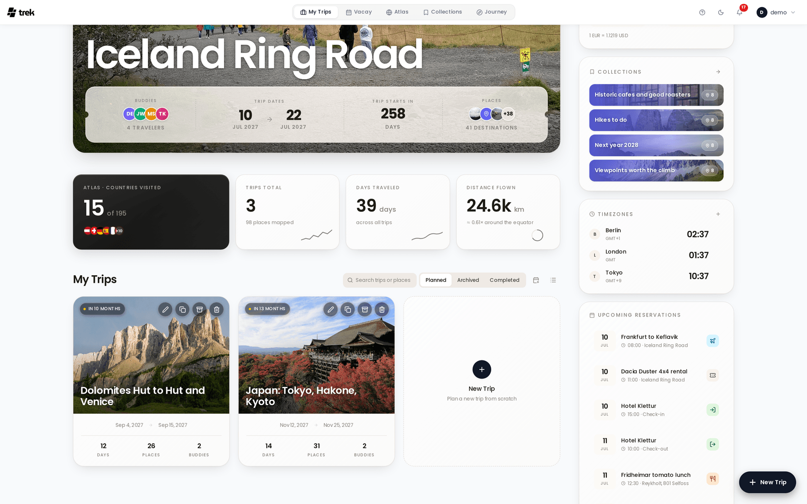
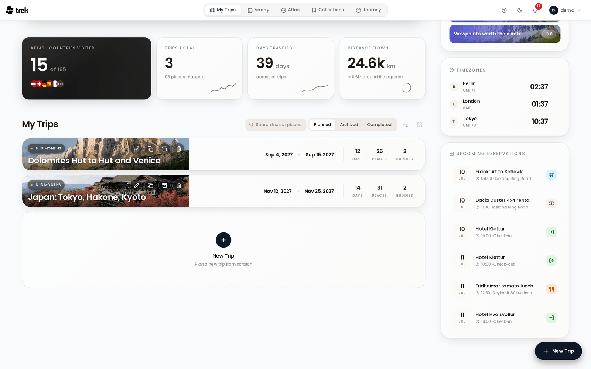
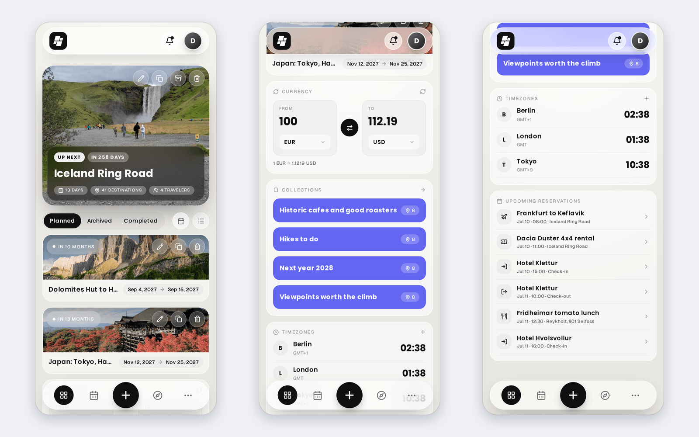

# My Trips Dashboard

The dashboard at `/dashboard` is your home base — it lists all your trips, lets you create new ones, and surfaces quick-access widgets.

## View Modes

Use the toggle button in the top toolbar to switch between **grid** (card thumbnails) and **list** (compact rows). Your preference is saved in `localStorage` under the key `trek_dashboard_view` and persists across sessions.

In both modes the dashboard shows a large [Spotlight card](#spotlight-card) for your most relevant trip at the top of the page — the toggle only changes how the trips below it are laid out. The spotlighted trip is taken out of that list when it earns the spot on its own: an ongoing trip, or the next upcoming one. If you have neither, the spotlight borrows your first trip for the header and that trip still shows up in the list below.

## Searching Trips

On desktop the trips section header has a search box, **Search trips or places**. It searches **every** trip you have, archived and completed ones included, whichever filter is selected:

- by the trip's **title** and **description**,
- by its **dates**, written as numbers (`2024-05`) or as words (`May 2024`, in your language),
- by a **place** on the trip, once you have typed at least two letters. A trip found this way lists the matching places under its dates.

Several words must all match, and accents do not matter, so `cafe` finds "Café". While a search is active, the **Planned / Archived / Completed** filter is dimmed and the grid shows only the matches; with none, it says *No trip matches "…"*. Clear the box with **×** or **Escape** to go back. Offline, the place part of the search is skipped and only titles, descriptions and dates are matched.

## Calendar Subscription

The calendar button next to the filter, **Subscribe to all trips**, opens one calendar feed for all your active trips. See [Calendar-Feeds](Calendar-Feeds).

## Sort Order

Trips are always sorted in this order:

1. **Ongoing** — trips where today falls between the start and end date.
2. **Upcoming** — future trips, sorted by start date ascending (soonest first).
3. **Past** — completed trips, sorted by start date descending (most recent first).

Trips without dates are treated as past.

## Spotlight Card

The first ongoing trip, or the next upcoming trip if none is ongoing, is promoted to a full-width **Spotlight card** at the top of the grid on desktop, where it carries a badge for the state of the trip (**LIVE NOW**, **STARTS TODAY**, **TOMORROW**, **UP NEXT** or **RECENT**), the action buttons on the cover, and a boarding pass strip below the title: your **Buddies**, the **Trip dates**, a countdown (days left, or **Trip starts in** a number of days) and the number of places as destinations. On mobile this card appears as a hero at the top of the page, with a progress bar for ongoing trips and a stats strip (days, places, travel companions).

If you have no trips yet, the spotlight card is not shown.

## Stat tiles

Under the spotlight card on desktop, a row of four tiles sums up all your trips:

| Tile | What it shows |
|---|---|
| **Atlas · Countries visited** | The number of countries found in the places and transports of your trips, of 195, with the first flags. A country you removed in [Atlas](Atlas) stays removed here. |
| **Trips total** | How many trips you have, and how many places are mapped on them. |
| **Days traveled** | The days across all trips. |
| **Distance flown** | The distance of your flights, and what that comes to in trips around the equator. |

Each tile is switched on or off under **Settings → Appearance → Dashboard widgets**, in the **Below the hero** group; see [Dashboard-Widgets](Dashboard-Widgets#showing-and-hiding-widgets). When all four are off the row disappears.

## Trips without dates

A trip with no dates is not past and not upcoming. Its card carries an **Idea** badge in place of a countdown, and, as described under Sort Order, it is sorted with the past trips.

## Archived Trips

Archived trips are kept out of the default list. The trips section header carries a **Planned / Archived / Completed** filter and the grid shows exactly one of those three sets — switch to **Archived** to see them. On desktop an archived card has the same four actions as any other card, with **Archive** turned into **Restore**. On mobile an archived card drops **Edit**: you can **Copy**, **Restore**, or permanently **Delete** the trip.

## Mobile Header

On mobile, the header is a floating glass bar: the TREK logo on the left (tap it to scroll back to the top), a **Notifications** button (bell icon, with a dot when something is unread) that navigates to `/notifications`, and your avatar on the right. On a computer, the notifications page and the bell's panel show a coloured tile for what each notification is about and group the list under Today, Yesterday, the weekday or the date; see [Notifications](Notifications). The top of the mobile dashboard greets you (*Good morning,*, *Good afternoon,* or *Good evening,*), and an ongoing trip is marked **Live Now**. The avatar opens the user menu with settings, the admin panel for admins, the dark/light/auto theme cycle, and sign out.

## Dashboard Widgets Sidebar

On wide screens a sticky right column shows the **Currency**, **Collections** (only with the Collections addon enabled), **Timezones**, and **Upcoming reservations** widgets, plus any widget a plugin contributes. Each one is switched on or off separately for desktop and mobile under **Settings → Appearance → Dashboard widgets**; desktop also has a **Right sidebar** master toggle that removes the whole column, and the column disappears on its own once every widget in it is off.

On mobile, the same widgets are inline panels below the spotlight card, not a bottom sheet. By default the trip list comes first and the widgets stack underneath it. How they stack — and where the trip list sits among them — is set on the phone under **Settings → Appearance → Mobile → Dashboard order**.

See [Dashboard-Widgets](Dashboard-Widgets) for full usage details.

## Per-Trip Actions

On desktop the action buttons sit on the card cover at all times — hovering the card only lifts them from a slightly dimmed resting state to full opacity, and list rows carry the same buttons on their cover. On mobile, action buttons are always visible directly on the card cover. The available actions are:

| Action | Permission required |
|---|---|
| **Edit** | `trip_edit` or `trip_cover_upload` on that trip |
| **Copy** | `trip_create` |
| **Archive / Unarchive** | `trip_archive` on that trip |
| **Delete** | `trip_delete` on that trip |

Which actions appear depends on layout and archive state, not on your role — the dashboard draws the buttons without checking permissions. On mobile a grid card leaves **Archive** out (it lives in the edit sheet) while a list row includes it. The permissions above are enforced by the server: an action your role is not allowed to perform comes back as a 403 and you get an error message instead of the button being hidden. Permissions do take effect inside the trip dialog — without `trip_cover_upload` the cover-image panel is not shown, and without `trip_edit` the title, description, and currency fields are read-only.

## Empty State

When you have no trips, the dashboard shows the TREK mascot with the caption **No trips yet**. Start one from the **New Trip** button in the bottom-right corner or the dashed **New Trip** tile at the end of the grid; both open the [Creating-a-Trip](Creating-a-Trip) dialog. On mobile the empty state itself carries a **Create First Trip** button.

## Related Pages

- [Creating-a-Trip](Creating-a-Trip)
- [Trip-Planner-Overview](Trip-Planner-Overview)
- [Dashboard-Widgets](Dashboard-Widgets)
- [Calendar-Feeds](Calendar-Feeds)
- [Notifications](Notifications)
