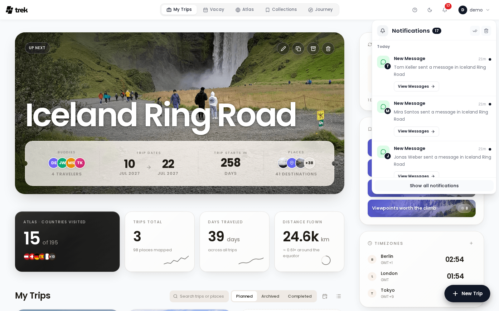

# Notifications Inbox

Everything TREK tells you in the app lands in one inbox: trip invitations, chat messages, booking changes, reminders, hints about your tours, update notices. You reach it through the bell in the navigation bar, and the full list opens as its own page at `/notifications`.

Which events reach the inbox, and which also go out by email, webhook, ntfy or Web Push, is set in **Settings → Notifications**; see [Notifications](Notifications).

## The bell

The bell in the navigation bar shows how many notifications you have not read yet, up to **99+**. A click opens a panel with the newest ones:

- The head shows **Notifications** with the number of unread ones, and the tools **Mark all read** and **Delete all**.
- The list is cut into days, with the day's heading staying at the top while you scroll through it.
- **Show all notifications** at the bottom opens the full inbox page.

Following a notification from the panel closes it. New notifications arrive live over TREK's connection, so the count and the panel update without a reload.

## The inbox page

The page lists every notification, newest first, and loads older ones as you scroll down.

- **The head** shows a tile, **Notifications**, how many are unread and how many there are in total, plus **Mark all read** and **Delete all**. **Delete all** asks first: *Every notification is removed for good. This cannot be undone.*
- **All** and **Unread** above the list switch between every notification and only the unread ones.
- **The days**: each day is a card of its own, headed *Today*, *Yesterday*, a weekday for the rest of the week, and the date for anything older (with the year when it is not this one).
- **Nothing there** shows **No notifications** and *You're all caught up!*

## A notification

Each notification has a tile on the start side that says at a glance what it is about, with a small picture of who sent it on its corner:

| Tile | For |
|---|---|
| Plane | Trip invitations and trip reminders |
| Speech bubble | Messages in a trip's chat |
| Ticket | Booking changes |
| Backpack | Packing items you were tagged on |
| Checklist | To-dos coming due |
| Calendar | Vacay invitations and shared calendars |
| Bookmark | Collection invitations |
| Photos | Photos shared with you |
| Mountain | Hints on your tours, such as a [wanderer](Wanderer) trail that changed |
| Sparkles | A new TREK version |
| Warning | Something that needs your attention, such as a photo provider that was disconnected |
| Bell | Everything else |

Next to the tile come the title, the message and the time: under an hour it reads like *5m*, after that the clock time, since the day heading says the rest. Unread notifications are set in bold with a dot in the accent colour.

What you can do with a notification:

- **Follow it.** A notification that points somewhere carries a button, such as **View Tour** or **View Details**, and the button marks it read on the way.
- **Answer it.** Some ask a yes or no question, such as an invitation, and carry its two buttons. You answer once; afterwards the button you chose stays marked.
- **Mark as read** or **Mark as unread**, and **Delete**. On the desktop these come forward when you point at the row or move to it with the keyboard, so the list reads as messages rather than as buttons.

## On a phone

On a phone the bell sits at the top of the dashboard and opens the same inbox as a full screen, with a back button and the bulk tools in its top bar, **All** and **Unread** below it, and the notifications as one card. Tapping an unread notification marks it read; its buttons sit as chips under the text, and **Delete** at the end of the row. See [Mobile-App](Mobile-App).

## See also

- [Notifications](Notifications): channels, events and the preferences matrix
- [Admin-Notifications](Admin-Notifications)
- [Mobile-App](Mobile-App)
