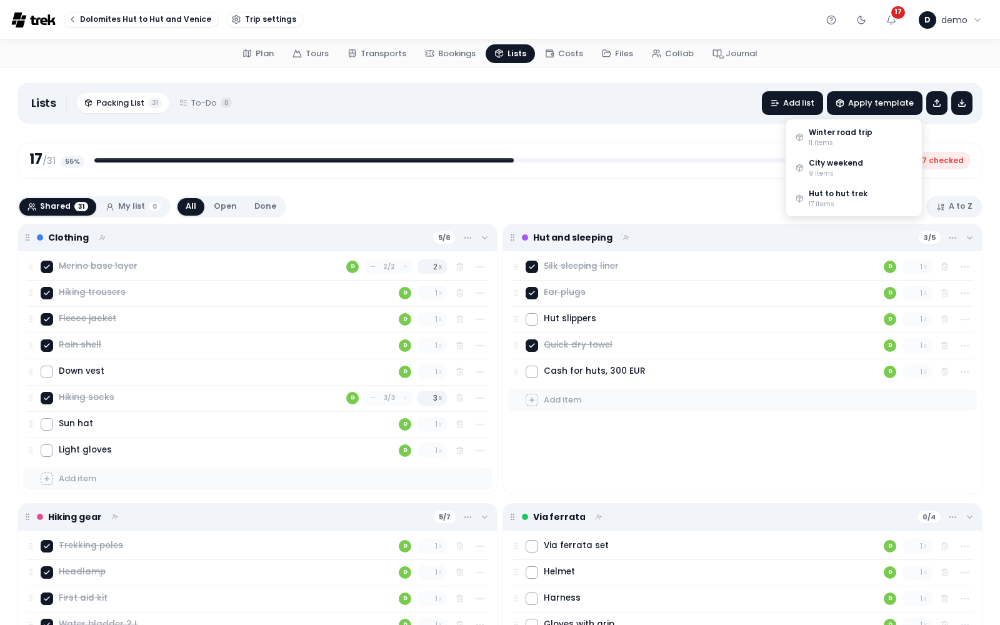

# Packing Templates

Reuse packing lists across trips using pre-built templates.

The screenshot shows the **Apply template** menu in the Lists bar of a trip's packing list. Admins build the templates on the **Packing Templates** card on **Admin > Personalization**, see [Admin-Packing-Templates](Admin-Packing-Templates).

## Applying a template

In the Lists bar of the packing list, click **Apply template** (package icon). A menu lists all available templates, each with its name and item count. Click a template to apply it.

Applying a template copies all categories and items from the template into the current trip's packing list; existing items are not removed. Items keep the category names of the template, so they appear alongside any existing items that share the same category name. Each item brings its weight, quantity and bag along; a bag the trip does not have yet is created. The items land in the view that is open: in **Shared** they go to the group pool, in **My list** they are Personal.

Requires the `packing_edit` permission.

You do not need an admin for a template of your own: a list saved with **Export** as **CSV for import (.csv)** can be imported into the next trip, see [Packing-Lists](Packing-Lists#printing-and-exporting).

On the desktop planner the **Apply template** button appears as soon as at least one template exists; it is not permission-gated in the UI. A member without `packing_edit` still sees it; the server refuses the apply and the app shows a *Failed to apply template* toast. On the phone the packing tab does gate it: **Apply template** sits in the packing list's action menu and only shows for members who have `packing_edit`.

## Saving the current list as a template

In the Lists bar, click **Save as template** when the list has items. A small dialog asks for the **Template name**; click **Save**. The template captures the **Shared** pool plus your own items; other members' Personal items, and the items they shared with specific people, are deliberately left out. Each item is stored with its name, category, weight, quantity and bag name; the checked state is not.

The **Save as template** button only appears when there are items in the list, and you are an instance admin with the `packing_edit` permission. Non-admins can apply templates but not create them; the API answers a non-admin with `403 Admin access required`.

> **Admin:** Templates are created and managed in [Admin-Packing-Templates](Admin-Packing-Templates), on the **Packing Templates** card of the admin panel's **Personalization** tab. Each template has a three-level structure: template → categories → items.

## See also

- [Packing-Lists](Packing-Lists)
- [Admin-Packing-Templates](Admin-Packing-Templates)
