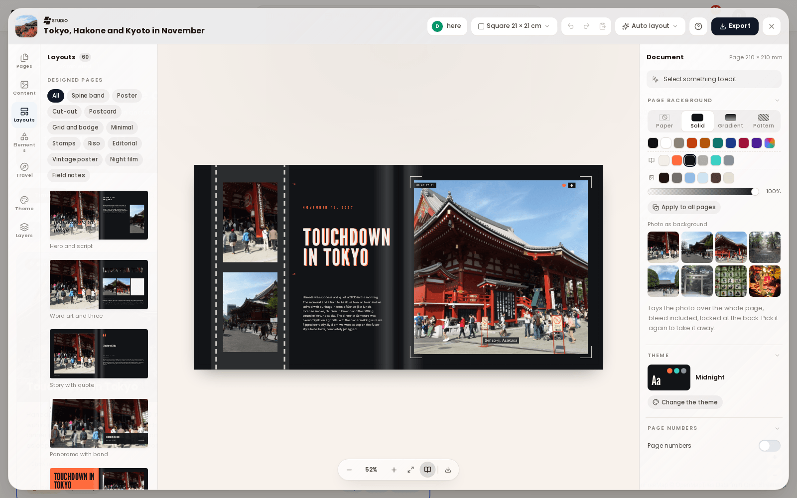

# TREK Studio

TREK Studio turns a [journey](Journey-Journal) into a photo book you can print. It lays the journey's entries, photos and route out as pages, lets you change every one of them, and makes a print ready PDF at the end. A book belongs to its journey: the photos, words, places and figures it shows come from there, and several people can design it at the same time.

## Opening Studio

Open a journey and press **Studio** in its header. The designer opens over the journey at `/journey/:id/studio`, so the journey stays open underneath and **Back to the journey** returns you straight to it.

Studio needs room to work. It is desktop only and needs a window at least 1024 px wide. In a narrower window, or on a tablet, it shows *Studio needs a bigger screen* with a way back, and on a phone it is not offered at all. Making the PDF is desktop only as well.

Who may do what follows the journey exactly: anyone who may read the journey may open its book, and only those who may edit the journey may change or delete it. A reader sees **Read-only, not saved** in the header.

## The screen

| Area | What it holds |
|---|---|
| Header | **Page format**, **Auto layout**, undo and redo, paste, the **Assistant**, help, and **Export** |
| Left rail | The sections that put things on a page: **Pages**, **Content**, **Layouts**, **Elements**, **Travel**, and set apart below them **Theme** and **Layers** |
| Workbench | The spread you are working on, with zoom (**Zoom in**, **Zoom out**, **Fit to view**) and **Book view** |
| Properties | Everything about what is selected, on the right |

The rail and the tabs inside its panels answer to the arrow keys.

## Page format and the shape of the book

**Page format** offers **Square 21 × 21 cm** (the default), **Square 30 × 30 cm**, **A4 landscape**, **A4 portrait**, **A5 landscape** and **Custom size** in millimetres. Every page has 3 mm of bleed (what is cut off at the edge) and a 5 mm safe area, both of which the header can show as guides.

A book follows the shape of a bound one:

1. the **Cover**, whose inside stays blank,
2. a single first page on the right, page 1, where a title page or a dedication goes,
3. the double pages (spreads) in between,
4. a single last page on the left,
5. the **Back cover**, whose inside stays blank too.

The covers and the single first and last pages stay where they are; new spreads always go between them. **Page numbers** can be switched on with nothing selected: outer, inner or centred, with where they start and their margin. They count from the first page, and the number on screen is the number that prints.

## Pages

The **Pages** panel lists the book. **Add spread** adds one after the last, and each spread offers **Insert a spread after this one**, **Duplicate spread**, **Move earlier**, **Move later** and **Delete spread**. **Book view**, beside the zoom buttons, draws the fold down the middle of each spread on the workbench and in the page list; it is on by default.

### Auto layout

**Auto layout** in the header builds pages out of the journey for you:

- **This spread** lays the spread on screen out again from the journal entry it came from, on another design. It is only offered on a spread that auto layout made.
- **The whole book** replaces every page, keeping your title and page setup.

Both are ordinary undo steps: press one, look at the result, and undo it if you liked the old one better.

An element that auto layout tied to a journal entry follows that entry, so a corrected caption in the journal reaches the book. Editing the element in Studio breaks the link (*Follows the journal entry. Editing it here breaks that link.*).

## Content

**Content** holds the journey's own **Photos** and **Entries**. **Search photos and entries** finds one, and **Filter photos** narrows the photos to **All photos**, **Not in an entry**, **Just uploaded** or **This page**. Drag a photo onto the page or onto an empty frame, or use **Add to this page**. An entry adds its title, story, place or **Pros & Cons** as blocks of their own.

- **Upload photos** adds pictures from your computer. They go into the open entry, or into the journey's gallery when none is open. Videos are left out: a book holds pictures.
- With Immich or Synology Photos connected, **From Immich** or **From Synology Photos** picks photos from your library the way the journey gallery does. See [Photo-Providers](Photo-Providers).

## Layouts

**Layouts** arranges a whole page at once, with that page's own photos and words.

**Designed pages** come first: pages laid out by a designer, 48 for the cover and the other single pages and 60 double spreads, in twelve styles (**Spine band**, **Poster**, **Cut-out**, **Postcard**, **Grid and badge**, **Minimal**, **Stamps**, **Riso**, **Editorial**, **Vintage poster**, **Night film** and **Field notes**). Each card shows the page you are on as the click would lay it, with its own photos and words and in the book's theme. The **Style** chips narrow the set to one look. What a design has no room for stays with the page.

Below come **My layouts** and the **Built in** ones: thirteen spread layouts (**Hero and story**, **Four up**, **Strip and text**, **Mosaic** and more) and five for the cover and back.

**Save this page as a layout** keeps the arrangement of a page without its photos, for every editor of this book. Applying it lays another page out the same way and keeps that page's photos and words. A book keeps up to 24 layouts.

## Elements

**Elements** adds things to a page, in six tabs:

| Tab | What it adds |
|---|---|
| Text styles | Ready made titles, badges and stamps, chapter numbers, quotes, captions and coordinates, set in your book's title and sized to fit. A style arrives selected as one set; click a single part to change its words. |
| Shapes | Basic shapes, polygons, stars, arrows, speech bubbles, travel shapes, decoration and banners |
| Lines | Straight and drawn lines in several strokes |
| Frames | **Empty frame**, frame styles (**Plain**, **Polaroid**, **White border**, **Drop shadow**, **Film**, **Taped**), frame shapes and **Grids** of empty frames |
| Icons | A searchable icon library, **For travel** or **All icons** |
| Stickers | A sticker library in twelve themes, from travel things and landmarks to doodles and ornaments, with **Recently used**. Click one to place it in the middle of the page, or drag it where it should go. |

An empty frame marks where a picture goes; drop a photo on it from **Content**.

## Travel

**Travel** builds figures out of the journey itself. When the journey changed since they were taken, **Update from journey** refreshes them.

- **Maps**: a **Route map** of the journey, either **Whole journey** or **One trip at a time**, in the styles **Minimal**, **Outline**, **Paper** or **Dark**. The source can be outlines, relief, satellite or map tiles. **Roads** asks a routing service for the way each leg was driven and keeps it in the book, so it prints the same line offline. A map can sit **In a box** or be **Cut to shape** of a country, and shows how sharp it prints at its size.
- **Figures**: distance, days, steps, photos, countries, places and the furthest point, as single figures or together, in looks from **Classic** and **Ticket** to **Odometer**, **Road sign** and **Sketch**.
- **Countries**: the countries of the journey as outlines, lists or flags, in looks such as **Visa**, **Stamp**, **Postcard** or **Luggage label**.
- **Marks**: **Date**, **Day counter**, **Coordinates**, **Flag** and **Distance**.
- **Stops**: every stop counts toward the route, the distance and the countries. Switch one off to leave it out, your home airport for instance.

## Theme

**Theme** sets the look of the whole book. Pick one of seventeen themes, such as **Poster pop**, **Postcard**, **Riviera**, **Nordic**, **Alpine**, **Riso print**, **Magazine**, **Midnight** or **Field notes**, then **Apply to the book** or **Apply to this page**. Colours and type that follow the theme change with it; everything else stays as it is.

- **Palette**: the paper, ink, muted and accent colours. **Colours from the photos** takes them from your pictures.
- **Typefaces**: the display, heading, body and script faces.
- **Motifs**: the sticker themes that suit the look.
- **Decoration**: **None**, **Light** or **Rich**.
- **Also restyle what isn't linked yet** first links backgrounds, text and shapes to the theme. White words over photos stay as they are.

A colour that follows the theme reads **Theme colour** in the properties; **Stop following the theme** frees it. **Back to the original theme** undoes a theme change.

## Properties

**Properties** on the right edits whatever is selected, in the same order for every kind: what the element is or says, then its position and size, then its look, then its effects, and last **Arrange**. The groups you use are open, and a group opens by itself on an element that already uses it. With nothing selected the panel shows the page background, the book's theme and the page numbers.

### Photos

- **Crop**: **Fill** or **Fit**, zoom, **Mirror**, and a focal point you drag to choose what stays in frame.
- **Look**: the filters **Original**, **Black & white**, **Warm**, **Cool**, **Faded** and **Punchy**, and **Adjust** for brightness, contrast, saturation and warmth.
- **Border and shadow**, a **Cutout edge**, a corner radius, and **Cut to shape** to put the photo in a shape.
- **Fill page** or **Fill spread** stretches the picture over the whole page, bleed included, and sends it behind everything else.
- Studio says how sharp a photo prints (*Prints at about* so many dpi) and warns when it would look soft.

### Text

- Typeface, weight, size, line height, tracking, alignment (including **Justified**) and colour. **Change typeface** searches the faces by kind: sans serif, serif, elegant display, condensed and poster, heavy and retro, script and handwriting, monospace. **Used in this book** lists the faces you already have.
- **Case and placement**: **As typed**, **Capitals**, **Lower case** or **Small caps**; the text's place in its frame; and **Shrink to fit**, which treats the size you set as the largest.
- **Effects**: **Hard shadow**, **Marker band**, **Curve** (**Arc**, **Circle** or **Bend**), **Hollow** letters, and **Photo inside the letters**, where a photo shows through the type.

### Shapes, lines and backgrounds

A shape, a sticker's colours and the page background take a fill: **Solid**, **Gradient** (linear or radial, with colour stops) or **Pattern**. Shapes also take an outline (**Solid**, **Dashed** or **Dotted**), opacity and rotation.

### Arrange

**Arrange** aligns and stacks: **Bring to front**, **Bring forward**, **Send backward**, **Send to back**, **Lock**, **Duplicate**, **Delete**, grouping, **Copy style** and **Paste style**, and **Show in Layers**. Several selected elements can be aligned to each other, to the page or to the safe area, and spaced evenly.

## Layers

**Layers** lists the page front to back. Drag a row to restack it, double click a name to rename it, **Hide** or **Show** an element, and **Group** or **Ungroup** several. Double click an element on the page to work inside its group.

## Keyboard shortcuts

| Keys | Action |
|---|---|
| Ctrl+Z, Ctrl+Shift+Z | Undo, redo |
| Ctrl+C, Ctrl+V | Copy and paste elements, onto any page |
| Ctrl+D | Duplicate |
| Ctrl+A | Select everything on the page |
| Ctrl+G, Ctrl+Shift+G | Group, ungroup |
| Ctrl+Alt+C, Ctrl+Alt+V | Copy style, paste style |
| Ctrl+], Ctrl+[ | Bring forward, send backward; with Shift to the front or the back |
| Arrow keys | Move by 1 mm, by 10 mm with Shift |
| Delete or Backspace | Remove what is selected and not locked |
| Escape | Inside a group, back to the whole group |

On a Mac, Ctrl is Cmd. While you type in a field or a text on the page, the keys are the text's.

## Saving and designing together

Studio saves as you go. The header shows **Saving**, **Saved**, or **Not saved** with **Try again**.

Several people can design the same book at once. Everyone sees the others' pointers with their names, and who is **here**. A save is passed to the others live. When a save lands on a version somebody else changed in the meantime, Studio does not overwrite their work: *Someone else saved this book* offers **Take theirs** or **Keep mine**.

**Download this spread** saves the design of the spread you are on as a file, without the photographs, and **Import** adds such a spread to another book.

## Export and printing

**Export** opens the print settings:

- **Layout**: **Single pages** (one leaf per sheet, in reading order, what a printer wants) or **Spreads** (two pages at a time, the way the book opens, for reading).
- **Finishing**: **Crop marks** adds the bleed on every edge and marks where to cut.

The note under it says how many sheets at what size you get. **Print view** opens the book in your browser's print view, and **Save as PDF** turns it into a PDF there. The button waits (**Preparing**) until every photo and typeface has loaded, so nothing prints as an empty box or in the wrong font.

## The book assistant

With the [AI Assistant](AI-Assistant) set up, **Assistant** in the Studio header opens the **Book assistant** beside the page (*Design the book together with the assistant*). Ask it *What should the book look like?* and it can:

- start the book, add, change, move, duplicate and delete pages, change the cover, the page format and the theme, and save a page as a layout,
- propose a whole book design in a style such as **Classic design**, **Minimal design**, **Editorial design**, **Journal design**, **Bold design** or **Scrapbook design**, with its colours and typefaces. You choose per page which pages take the new design,
- check a page and list what to fix, such as text running past its frame, something in the fold or past the edge, an empty photo frame, a photo that may print blurry, text that is hard to read, too many typefaces or the same layout again and again.

Every change arrives as a card you apply or discard, with **Show this page**, and can be undone, the same as in a trip. Someone who can only read the book can ask questions, but the assistant changes nothing for them.

**Pictures of your pages.** The assistant always reads a page as a description. To let it look at the page itself, Studio asks once: *The assistant can look at the page you are working on. Only that page goes to the provider, as a picture showing just the photos you added yourself.* **Show it pages** allows it for that connection, **Not now** keeps to descriptions. Photos added by other people are drawn as empty frames, and nothing of the picture is stored.

## See also

- [Journey-Journal](Journey-Journal)
- [AI-Assistant](AI-Assistant)
- [Photo-Providers](Photo-Providers)
- [Help-Center](Help-Center)
