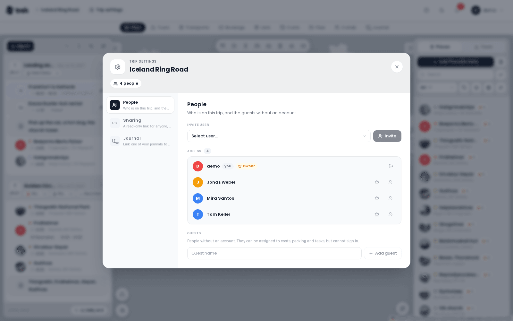
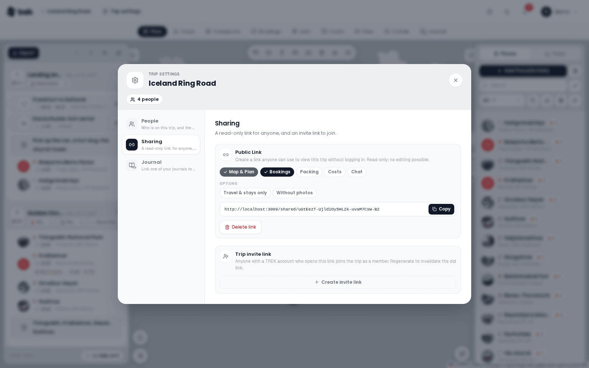

# Trip Members and Sharing



## Opening the Trip settings

- From the **trip planner**: click the **Trip settings** pill beside the trip's title in the top navigation bar.
- On **mobile**: open the trip, then **More** and the **Trip settings** row.

The dialog is headed **Trip settings**, with the trip's name under it and pills for the number of people on the trip and, once there are any, of its guests. A side navigation splits it into areas:

| Area | What it holds | Who sees it |
|---|---|---|
| **People** | Inviting users, the access list and the guests | Everyone on the trip |
| **Sharing** | The **Public Link** and the **Trip invite link** | Users with the `share_manage` permission |
| **Journal** | The journal linked to this trip | When the Journey addon is on and you may link a journal, or the trip already has one |

When only one area applies to you, the side navigation is hidden. On a narrow window the areas become pills above the content.

## People

The **Access** section lists everyone who has access to the trip, with a count.

- The **trip owner** is marked with an **Owner** badge and a crown.
- Your own entry carries a **you** badge (on the phone it reads **(you)**).
- A remove button appears on your own row, and on every non-owner row if you have the `member_manage` permission.

### Inviting Members

If you have the `member_manage` permission (default: trip owner), an **Invite User** control appears above the list. Select a user from the searchable dropdown and click **Invite**. The user is looked up by username or email on the server, added immediately, and the list refreshes. The invited user also receives an in-app notification.

### Removing a Member

Click the remove icon next to any member's name (**Remove access**). TREK asks first, in a dialog over the Share dialog, and removes the member only on **Confirm**.

If you click the remove icon next to **your own** name, the action is labeled **Leave trip**, and the same dialog asks *Leave trip? You will lose access.* before anything happens. Leaving reloads the page and returns you to the dashboard.

The trip owner cannot be removed through this panel.

### Transferring Ownership

Only the current owner sees a crown button (**Make owner**) next to each non-owner member. Click it and press **Confirm** in the dialog that asks *Transfer ownership to (name)? You will become a regular member.*; on confirm that member becomes the trip owner, you drop to a regular member, and the page reloads so the new permissions take effect everywhere.

Guests are never listed among the members, and the server refuses to hand ownership to one.

## Guest Members

Not everyone on a trip has — or wants — a TREK account. **Guests** let you add travel companions by name only, so you can assign them to costs, packing and tasks just like a real member, without creating a login for them.

Guests appear in their own **Guests** section below the members list, each with a **Guest** badge:

> People without an account. They can be assigned to costs, packing and tasks, but cannot sign in.

### Adding a guest

Only the **trip owner** can manage guests (this is stricter than inviting members, which uses the `member_manage` permission). In the owner's view, the Guests section has a **Guest name** field and an **Add guest** button — type a name and click Add. A guest has a display name only: no email, no password, and no way to sign in.

Other members see the Guests section too (when guests exist) but cannot add, rename or remove them.

> Two guests may share the same name — TREK stores the name you type as-is and keeps the two apart by their internal id, so assignments never get confused. A guest name may be at most 50 characters.

### What a guest can be assigned to

Once added, a guest can be picked anywhere a member can:

- **Costs** — added to expense splits (see [Budget-Tracking](Budget-Tracking)).
- **Packing** — assigned to packing items and categories (see [Packing-Lists](Packing-Lists)).
- **To-dos** — set as a task assignee.
- **Day plan** — added as a participant on activities and places.
- **Bookings**: set as a traveler on a reservation or a transport (see [Reservations-and-Bookings](Reservations-and-Bookings)).

### What a guest can never do

Guests are firmly scoped to the one trip. A guest can **never**:

- sign in (they have no credentials — password, SSO and password-reset all ignore guest accounts);
- receive notifications (no email and no in-app notifications are ever sent to a guest);
- appear anywhere outside the trip (they are excluded from the global user directory, the admin user list, invite pickers, and search);
- be made the trip owner.

These limits are enforced on the server, not just hidden in the UI.

### Renaming and removing

In the owner's Guests section, each guest row has a **Rename** (pencil) and a **Remove access** (trash) button. Rename turns the name into a field: Enter saves, Escape leaves it as it was. Removing a guest is **destructive and cascading**, so TREK asks in a dialog before it deletes, and removes the guest only on **Delete**:

> Remove this guest? Their assignments are removed and their share of each expense goes to the others in its split.

A share split by amount is handed to the others in equal parts, and a receipt split line by line is split again without the guest. A guest who paid for an expense, or who is part of a recorded payment, cannot be removed: TREK says so and keeps the guest, so the money stays on the books. Change the payer or delete the payment first.

There is no limit on the number of guests per trip.

> **AI / MCP:** an assistant can do all three (`create_trip_guest`, `rename_trip_guest`, `delete_trip_guest`) and is held to the same owner-only rule. See [MCP-Tools-and-Resources](MCP-Tools-and-Resources).

## Public Share Link

The **Sharing** area is only visible to users with the `share_manage` permission (default: trip owner). Its first section is **Public Link**.



A share link creates a **read-only, token-based URL**:

```
<your-instance>/shared/<token>
```

Viewers do not need to log in. The link can be shared with anyone.

### Creating a Link

Click **Create link** in the **Public Link** section. A URL is generated and shown with a copy button.

### Permission Toggles

Before or after creating the link, you can control what the link exposes. Toggle each section on or off with the pill buttons:

| Toggle | Default | What it shows |
|---|---|---|
| **Map & Plan** | Always on | Trip map, the day plan (days, activities, day notes) and the place list — cannot be disabled |
| **Bookings** | On | Reservations and accommodations |
| **Packing** | Off | Packing list |
| **Costs** | Off | Costs tab |
| **Chat** | Off | Read-only view of the trip chat (collab notes and polls are never shared) |

Changes to toggles take effect immediately for an existing link.

Under **Options**, two more switches narrow what the link shows: **Travel & stays only** (only transport and accommodation, without activities, day notes and empty days) and **Without photos** (the place photos are left out of the shared page). See [Public-Share-Links](Public-Share-Links#options).

### Deleting a Link

Click **Delete link** (red button below the URL) to revoke access. The token is invalidated; anyone who opens the old URL now sees *Link expired or invalid*.

## Trip Invite Link

Below the public link, in the same **Sharing** area, users with the `share_manage` permission can also create a **trip invite link**: a single rotating link that lets people **join the trip as members**:

```
<your-instance>/join/<token>
```

Unlike the read-only share link, this one is **not anonymous**:

- Whoever opens it must have a TREK account and be **signed in**. If they are not, they are sent to the login page and returned to the invite afterwards — there is **no registration** from this link.
- Opening it while signed in shows a confirmation card naming the trip. Clicking **Join trip** adds you as a **member** (the same access a manually-added member gets) and opens the trip. The owner and existing members see the same card and are simply taken to the trip when they accept.
- To invite people who do **not** yet have an account, use an admin invite link with an optional trip binding instead — see [Invite-Links](Invite-Links).
- Someone another member **removed** from the trip cannot rejoin through the invite link, old or regenerated; they see that they were removed. Adding them again by name in the Trip settings lets them back in. Someone who **left** the trip on their own can still rejoin through the link.

### Creating and revoking

- Click **Create invite link** to generate the link, then copy it with the copy button.
- Click **Regenerate** to rotate the token — the previous link stops working immediately.
- Click **Disable** to remove the link entirely.

> **Admin:** To invite users who do not yet have an account, create invite links in the admin panel. See [Invite-Links](Invite-Links).

## Journal

With the Journey addon on, the **Journal** area links one of your journals to the trip. Whoever you let in opens it right inside the trip, in its Journal tab, live.

- **Link a journal** shows your journals; pick one and click **Link journal**. Only the journal's owner can link it, and on the trip side the **Link a journal** permission (`journal_link`) decides who may.
- Under **Access for trip members** you choose, per person, **Read**, **Edit** or **No access**, or set everyone at once with **Everyone can read** or **Nobody**. People who get access to the journal for the first time are flagged before you save.
- Once linked, the card shows a **Linked** badge and your role (**Your journal**, **You can edit** or **You can read**). **Change journal** swaps it, **Edit access** reopens the access list, and **Unlink** removes the Journal tab from the trip. People you added in the journal itself keep their access when you unlink.
- Linking needs a connection.

See [Journey-Journal](Journey-Journal) for the journal itself.

## Related Pages

- [Public-Share-Links](Public-Share-Links)
- [Invite-Links](Invite-Links)
- [Creating-a-Trip](Creating-a-Trip)
- [Trip-Planner-Overview](Trip-Planner-Overview)
- [Trip-Settings](Trip-Settings)
