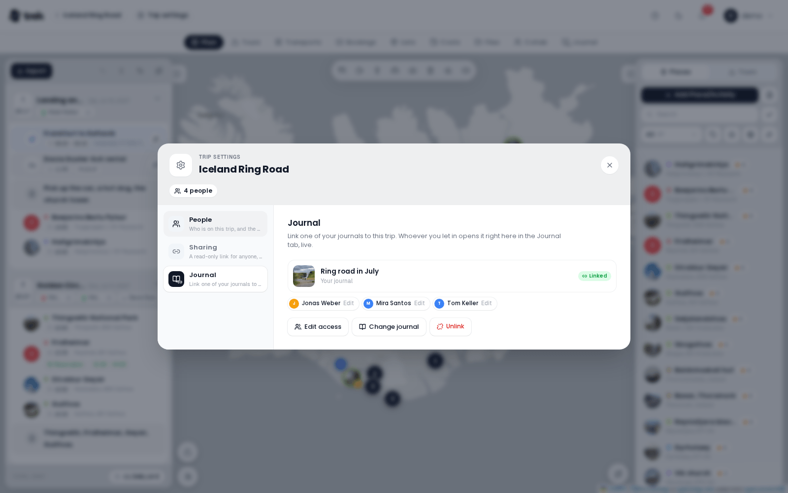

# Trip Settings

**Trip settings** gathers who is on a trip, how others get in, and which journal the trip shows, in one dialog with three areas: **People**, **Sharing** and **Journal**. The trip's own details (title, description, dates, currency, cover) are edited with **Edit Trip** instead; see [Creating-a-Trip](Creating-a-Trip).

## Opening it

- **On the desktop**, open a trip and press **Trip settings** in the navigation bar, the pill right beside the trip's name.
- **On a phone**, open the trip's **More** sheet and tap **Trip settings**. The same areas open as a sheet. **Edit Trip** sits in the same sheet for those who may edit the trip. See [Mobile-App](Mobile-App).

On a wide screen the areas are listed down the left side, each with a line saying what it is for; on a narrow one they are a row of pills above the content. The head of the dialog shows how many people and guests the trip has.

## People

*Who is on this trip, and the guests without an account.*

- **Invite User** adds someone with a TREK account straight away: pick them and press **Invite**. When everyone already has access, the dialog says *All users already have access.*
- **Access** lists the members with their role. The owner carries a crown. **Make owner** hands the trip to another member, **Remove access** takes someone off the trip, and on your own row **Leave trip** takes you off.
- **Guests** are *people without an account. They can be assigned to costs, packing and tasks, but cannot sign in.* **Add guest** names one; a guest can be renamed or removed later.

Adding and removing members needs the **Add / remove members** permission, which by default only the trip owner has. Everything about members, guests and ownership is on [Trip-Members-and-Sharing](Trip-Members-and-Sharing).

## Sharing

*A read-only link for anyone, and an invite link to join.*

- **Public Link**: *Create a link anyone can use to view this trip without logging in.* **Create link** makes it. The chips choose which parts it shows (**Map & Plan** always, then **Bookings**, **Packing**, **Costs** and **Chat**), and **Options** narrow it to **Travel & stays only** or **Without photos**. **Delete link** turns it off. See [Public-Share-Links](Public-Share-Links).
- **Trip invite link**: *Anyone with a TREK account who opens this link joins the trip as a member.* **Create invite link** makes one, **Regenerate** replaces it so the old one stops working, and **Disable** turns it off. See [Trip-Members-and-Sharing](Trip-Members-and-Sharing#trip-invite-link).

Each link has a **Copy** button. Managing the links needs the **Manage share links** permission, by default the trip owner's.

## Journal

*Link one of your journals to this trip. Whoever you let in opens it right here in the Journal tab, live.*

A trip can show one journal from the [Journey](Journey-Journal) addon. Once linked, the trip gets a **Journal** tab, marked with a book with a link on its corner, and the journal opens inside the trip for everyone you let in. It is the real journal, not a copy: what is written there appears in the tab as it happens.

### Linking a journal

1. Open **Trip settings → Journal** and press **Link a journal**.
2. **Choose a journal** from your own journals. A journal you only write in is not yours to give away, so it is not listed. Without a journal of your own the dialog says *You have no journal yet. Create one in Journey first.*
3. Under **Access for trip members**, give each member **No access**, **Read** or **Edit**. **Everyone can read** and **Nobody** set the whole list at once.
4. Press **Link journal**.

Before saving, the dialog names the people the link would let in for the first time: *they will get access to this journal for the first time and from then on also see it in their own journal list.*

Guests cannot sign in, so they are never on this list, and neither is the journal's owner, who has access anyway.

### Once it is linked

The area then shows the journal's cover and title, **Linked**, and what you may do in it: **Your journal**, **You can edit** or **You can read**. When only you can open it, it says *Nobody else from this trip has access yet.*

- **Edit access** changes who of the trip may read or edit. **Access saved** confirms it.
- **Change journal** links another of your journals instead.
- **Unlink** removes the link. *The Journal tab disappears from this trip. Members who could only open the journal through this trip lose access; people you added in the journal itself keep theirs.*

The access a link gives lasts as long as the link holds a member and that member stays on the trip. Someone who leaves the trip loses the access they had through it.

### Who may link

Linking a journal, or changing who may open it, gives other people access to that journal, so it needs both: you own the journal, and you hold the trip's **Link a journal** permission (by default the trip owner; an administrator can widen it to all members, see [Admin-Permissions](Admin-Permissions)). Taking the link down only takes access away, so either one is enough for **Unlink**.

A member the journal is closed to, and who can do nothing about the link, does not see that the trip has one. Linking needs a connection; offline the dialog says *Linking a journal needs a connection.* With the Journey addon switched off, the Journal area and the tab are not shown.

The [AI Assistant](AI-Assistant) can propose the link as a card too (*Show the journal in this trip*), which you apply like any other change.

## See also

- [Trip-Members-and-Sharing](Trip-Members-and-Sharing)
- [Public-Share-Links](Public-Share-Links)
- [Invite-Links](Invite-Links)
- [Journey-Journal](Journey-Journal)
- [Creating-a-Trip](Creating-a-Trip)
